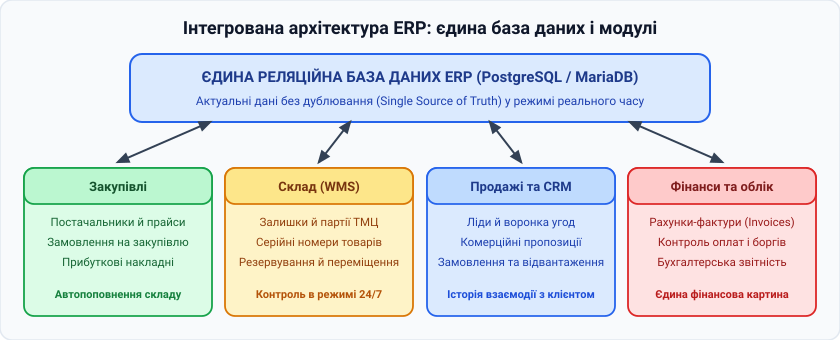
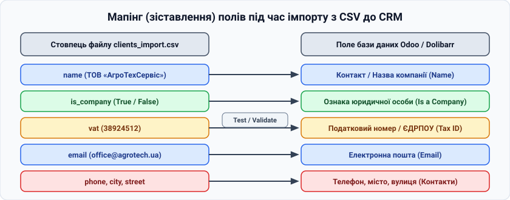

# Урок 51. ERP- та CRM-системи (Odoo, Dolibarr)

<div class="how-to">

**Як працювати з уроком**

1. Ознайомтеся з теоретичними засадами функціонування систем класу ERP та CRM, вивчіть структуру модулів та відмінності між платформами Odoo і Dolibarr.
2. Виконайте покрокове практичне завдання з підготовки, валідації та імпорту бази контрагентів у форматі CSV, а також проведіть операцію оформлення комерційної пропозиції.
3. Закріпіть навички у блоці **«Спробуйте самі»** та дайте відповіді на 10 запитань тесту.

</div>

## Мета уроку

Ви дізнаєтеся, як сучасні підприємства об'єднують управління фінансами, складом, закупівлями та клієнтською базою в єдиному цифровому середовищі, і чому використання розрізнених електронних таблиць поступається комплексним системам. На практиці ви:

- навчитеся структурувати дані контрагентів та товарів для бізнес-систем відповідно до вимог реляційних баз даних;
- підготуєте та перевірите CSV-файл із клієнтською базою для масового імпорту;
- виконаєте мапінг (зіставлення) полів даних у CRM-модулі;
- пройдете повний цикл обробки ліда: від первинного звернення через воронку продажів (Sales Pipeline) до формування комерційної пропозиції та рахунка-фактури.

## Що знадобиться

- Веббраузер (Google Chrome, Mozilla Firefox або Microsoft Edge) для роботи з вебінтерфейсом ERP/CRM.
- Табличний процесор (LibreOffice Calc або MS Excel) або текстовий редактор із підтримкою кодування UTF-8 (VS Code, Kate, Notepad++) для підготовки CSV-файлів.
- Доступ до демонстраційного стенду або локально розгорнутого екземпляра **Odoo Community** (наприклад, [demo.odoo.com](https://demo.odoo.com)) чи **Dolibarr ERP & CRM** ([demo.dolibarr.org](https://demo.dolibarr.org)).
- Термінал Linux або командний рядок Windows (опціонально для перевірки файлів утилітами командного рядка).

## Теорія

<div class="clip">


*Логотип мови програмування Python<sup>[1]</sup>*

</div>

### Концепція ERP: подолання інформаційної ізоляції

У класичній моделі підприємства минулих років кожен підрозділ працював у власному інформаційному просторі: бухгалтерія вела облік в одній програмі, відділ збуту зберігав списки клієнтів у файлах Excel, склад використовував окремі картки обліку залишків, а керівництво отримувало запізнілі паперові звіти. Такий підхід називається **інформаційною ізоляцією (data silos)**. Його наслідками є дублювання записів, розбіжності в залишках товару, помилки операторів під час ручного перенесення даних та втрата замовлень.

**ERP (Enterprise Resource Planning — планування ресурсів підприємства)** — це інтегрована програмна система, що використовує єдину базу даних для управління всіма ключовими бізнес-процесами організації в режимі реального часу.

Головні модулі типової ERP-системи:
- **Управління закупівлями (Purchasing):** формування замовлень постачальникам, облік надходження товарно-матеріальних цінностей (ТМЦ).
- **Складський облік (Inventory/Warehouse):** відстеження залишків на складах, серійних номерів, партій, адресне зберігання, інвентаризація.
- **Продажі (Sales):** реєстрація замовлень покупців, відвантаження, ціноутворення та прайс-листи.
- **Бухгалтерський та фінансовий облік (Accounting/Invoicing):** взаєморозрахунки з контрагентами, банківські виписки, формування рахунків, податкова звітність.
- **Управління персоналом (HRM):** штатний розпис, облік робочого часу, нарахування заробітної плати.
- **Виробництво (Manufacturing/MRP):** технологічні карти, списання сировини, калькуляція собівартості.

<div class="clip">



*Інтегрована архітектура ERP-системи: єдина база даних та взаємодія модулів закупівель, складу, продажів і фінансів*

</div>

Коли оператор проводить накладну на надходження товару в модулі закупівель, система автоматично оновлює залишки на складі та створює запис про кредиторську заборгованість перед постачальником у модулі бухгалтерії без повторного введення даних.

### Концепція CRM: управління відносинами з клієнтами

**CRM (Customer Relationship Management — управління відносинами з клієнтами)** — це інформаційна система або спеціалізований модуль ERP, призначений для збору інформації про клієнтів, фіксації всієї історії взаємодії з ними (дзвінки, листи, зустрічі), автоматизації продажів та підвищення якості обслуговування.

Ключові поняття CRM:
1. **Лід (Lead):** «холодний» контакт або первинне звернення потенційного клієнта (заповнена форма на сайті, вхідний дзвінок, візитівка з виставки), зацікавленість якого ще не підтверджена.
2. **Контрагент (Partner / Contact):** фізична або юридична особа, чиї дані (ЄДРПОУ, банківські реквізити, контактні особи) внесені до офіційного довідника системи.
3. **Угода / Потенційна угода (Opportunity / Deal):** процес переговорів щодо продажу товарів чи послуг із конкретною грошовою оцінкою та очікуваною датою закриття.
4. **Воронка продажів (Sales Pipeline):** наочне представлення етапів, через які проходить угода від моменту виявлення потреби до підписання договору й отримання коштів. Зазвичай відображається у вигляді Kanban-дошки.

Типові стадії воронки продажів:
- **Новий (New):** заявка надійшла та зареєстрована оператором.
- **Кваліфікований (Qualified):** уточнено потреби клієнта, підтверджено платоспроможність та обсяг.
- **Комерційна пропозиція (Proposition):** сформовано та надіслано детальний розрахунок вартості.
- **Переговори (Negotiations):** узгодження остаточних умов договору.
- **Виграно (Won) / Втрачено (Lost):** фінальний результат угоди.

### Відкриті платформи: Odoo Community та Dolibarr

У секторі малого та середнього бізнесу (МСБ), а також у навчальних закладах широкої популярності набули системи з відкритим кодом (Open Source), які не потребують сплати коштовних комерційних ліцензій.

| Критерій | Odoo Community | Dolibarr ERP & CRM |
| :--- | :--- | :--- |
| **Технологічний стек** | Python, PostgreSQL, JavaScript | PHP, MariaDB / MySQL, JavaScript |
| **Архітектура** | Модульна, каркас ORM, вебклієнт SPA | Модульна процедурно-об'єктна, швидкий рендеринг |
| **Системні вимоги** | Середні (від 2 ГБ ОЗП для сервера) | Мінімальні (працює навіть на базовому хостингу) |
| **Інтерфейс** | Сучасний інтерфейс у стилі Material Design | Класичний інтуїтивний вебінтерфейс |
| **Гнучкість розширення** | Магазин додатків Odoo Apps (тисячі модулів) | Вбудовані модулі + маркетплейс DoliStore |
| **Підтримка локалізації** | Український інтерфейс, базова підтримка валют | Повна підтримка української мови та валют |

### Роль оператора з обробки інформації

Оператор є ключовою ланкою між первинними даними бізнесу та аналітичними звітами керівництва. До обов'язків оператора належать:
- введення та перевірка реквізитів контрагентів (виключення дублікатів за номерами телефонів, кодами ЄДРПОУ/РНОКПП);
- масовий імпорт каталогів товарів, прайс-листів та клієнтських баз із зовнішніх джерел (CSV, XLSX);
- забезпечення узгодженості типів даних (дати, числові значення цін, коди країн);
- формування вихідних первинних документів (рахунки на оплату, видаткові накладні, акти виконаних робіт) за затвердженими шаблонами.

<div class="more-link">

**Хочете знати більше?** <span class="optional">Необов’язково</span>

У промислових інформаційних системах передача даних між ERP та зовнішніми сервісами (банками, кур'єрськими службами, торговельними майданчиками Prom.ua або Rozetka) відбувається автоматично через **REST API** за допомогою формату **JSON** або протоколів електронного обміну даними **EDI (Electronic Data Interchange)**. Наприклад, коли покупець оформлює замовлення в інтернет-магазині, вебсервер передає запит `POST /api/v1/sales/orders` до ERP-системи, де автоматично бронюється товар на складі та формується черга на комплектування для комірника.

</div>

## Покроково

Розглянемо практичну роботу оператора: підготовку клієнтської бази для комп'ютерного сервісного центру, її імпорт до системи та проведення операції формування комерційної пропозиції.

### 1. Підготуйте структуру даних у файлі CSV

Для безпомилкового імпорту необхідно суворо дотримуватися назв полів і кодування символів. Створіть файл `clients_import.csv` у кодуванні **UTF-8 (без BOM)** із розділювачем «кома» (`,`).

Зміст файлу `clients_import.csv`:
```csv
name,is_company,vat,email,phone,city,street
ТОВ "АгроТехСервіс",True,38924512,office@agrotech.ua,+380442301122,Київ,вул. Польова 14
ПП "Вектор Плюс",True,41238901,info@vector-plus.com,+380674503344,Львів,вул. Стрийська 45
Коваленко Андрій Сергійович,False,,kovalenko.a@gmail.com,+380509988776,Дніпро,вул. Наукова 8
ФОП Бондаренко О. В.,True,3128912345,bonda.service@ukr.net,+380931122334,Харків,просп. Науки 22
```

> **Важливо для оператора:** Якщо назва компанії містить коми або лапки, вона обов'язково береться у подвійні лапки. Поле `is_company` вказує системі, чи створювати картку юридичної особи (`True`) чи картку фізичної особи / співробітника (`False`).

### 2. Перевірте файл на наявність помилок форматування

Перед завантаженням у виробничу систему переконайтеся, що файл не містить некоректних символів або порушеного розділення рядків. У терміналі Linux це можна зробити командою:

```bash
head -n 5 clients_import.csv
```

Переконайтеся, що кожен рядок містить рівно 7 елементів (відповідає кількості заголовків).

### 3. Виконайте мапінг полів та імпорт у системі (Odoo / Dolibarr)

Увійдіть у вебінтерфейс системи під обліковим записом оператора:
1. Перейдіть до розділу **CRM** або **Контакти (Contacts / Third Parties)**.
2. Знайдіть кнопку меню **«Дії» (Favorites / Action) -> «Імпорт записів» (Import records)** або **Tools -> New Import**.
3. Натисніть кнопку **«Завантажити файл» (Upload File)** та оберіть підготовлений `clients_import.csv`.
4. Перевірте таблицю зіставлення полів (Data Mapping):
   - `name` -> **Назва (Name)**
   - `is_company` -> **Це компанія (Is a Company)**
   - `vat` -> **ЄДРПОУ / ІПН (Tax ID / VAT)**
   - `email` -> **Електронна пошта (Email)**
   - `phone` -> **Телефон (Phone)**
   - `city` -> **Місто (City)**
   - `street` -> **Вулиця (Street)**
5. Натисніть кнопку **«Тест» (Test / Validate)**. Система повинна видати повідомлення: `«Все виглядає коректно» (Everything seems valid)`.
6. Натисніть **«Імпортувати» (Import)**.

<div class="clip">



*Мапінг (зіставлення) полів під час імпорту контрагентів із CSV-файлу до CRM-системи*

</div>

### 4. Зареєструйте лід та переведіть його у воронку продажів

1. Відкрийте розділ **CRM** (представлення «Канбан»).
2. Натисніть кнопку **«Створити» (New / Create)** на стадії **«Новий» (New)**.
3. Заповніть картку можливості:
   - **Організація / Контакт:** оберіть імпортованого клієнта `ТОВ "АгроТехСервіс"`.
   - **Тема угоди:** «Модернізація серверного вузла та монтаж СКМ».
   - **Очікуваний дохід:** `85 000` грн.
   - **Ймовірність успіху:** `30 %`.
4. Перетягніть картку мишею (Drag-and-Drop) зі стадії **«Новий»** на стадію **«Кваліфікований»**, коли менеджер підтвердить технічні вимоги замовника.

### 5. Створіть комерційну пропозицію та рахунок

1. Відкрийте створену картку угоди та натисніть кнопку **«Нова комерційна пропозиція» (New Quotation)**.
2. У табличній частині «Товари / Послуги» (Order Lines) додайте дві позиції:
   - Позиція 1: `Комутатор керований 24-порт Gigabit` | Кількість: `2` | Ціна: `12 500` грн.
   - Позиція 2: `Роботи з монтажу та конфігурації мережі` | Кількість: `1` | Ціна: `60 000` грн.
3. Система автоматично розрахує проміжну суму (`85 000` грн) та податки.
4. Натисніть **«Підтвердити замовлення» (Confirm)** — статус документа зміниться на **Замовлення на продаж (Sales Order)**.
5. Натисніть кнопку **«Створити рахунок» (Create Invoice)** та оберіть «Звичайний рахунок». Перегляньте згенерований друкований документ у форматі PDF.

<div class="try">

**Спробуйте самі**

Змоделюйте ситуацію: під час узгодження договору клієнт `ТОВ "АгроТехСервіс"` попросив знижку 5% на обладнання (позиція 1) та відтермінування платежу на 14 календарних днів.
1. Знайдіть у замовленні стовпець «Знижка (%)» (`Disc.%`) та встановіть для першого рядка значення `5`.
2. У вкладці «Інша інформація» (Other Info) знайдіть поле «Умови оплати» (Payment Terms) та виберіть `14 днів` (14 Days).
3. Перевірте, як змінилася загальна сума документа та яка дата оплати розрахована системою.

<details>
<summary>Перевірити очікуваний результат і повний розв’язок</summary>

**Розрахунок вартості зі знижкою:**
- Позиція 1: 2 шт. × 12 500 грн = 25 000 грн. Знижка 5 % від 25 000 грн = 1 250 грн. Вартість зі знижкою = 23 750 грн.
- Позиція 2: 1 послуга × 60 000 грн = 60 000 грн (без знижки).
- Загальна сума комерційної пропозиції становитиме: 23 750 + 60 000 = **83 750 грн**.

**Поле дати оплати в рахунку:**
Якщо сьогодні, наприклад, 16 листопада, система автоматично вирахує дату виконання зобов'язань: 16 листопада + 14 днів = **30 листопада**. У картці угоди CRM очікуваний дохід автоматично оновиться до значення 83 750 грн, а у фінансовому календарі з'явиться відмітка про плановане надходження коштів.

</details>

</div>

## Підсумок

- **ERP-система** забезпечує єдиний цифровий контур підприємства, виключаючи дублювання операцій і помилки ручного перенесення даних між складом, бухгалтерією та відділом збуту.
- **CRM-система** фокусується на управлінні взаємовідносинами з клієнтами, дозволяючи вести історію контактів, управляти воронкою продажів та прогнозувати доходи підприємства.
- Платформи **Odoo** та **Dolibarr** є відкритими та модульними: вони дозволяють підключати лише ті функції, які необхідні підприємству на поточному етапі розвитку.
- Для оператора з обробки інформації критично важливими є навички підготовки та валідації файлів обміну даними (CSV), контроль унікальності контрагентів та коректне оформлення первинних документів.

## Тест

<div class="test-box">

10 запитань за матеріалом уроку. На початку тесту вкажіть **прізвище, ім’я та групу**.

🔗 <!-- GOOGLE_FORM_URL:lesson-51 --> *(Посилання на Google Форму буде додано після масового імпорту тесту)*

</div>

## Додаткове завдання

<span class="optional">Необов’язково</span> Виконуйте для поглиблення практичних навичок роботи з даними бізнес-систем.

**Базовий рівень.** Створіть за допомогою текстового редактора або LibreOffice Calc CSV-файл `products_import.csv` для імпорту товарної номенклатури сервісного центру (мінімум 5 позицій) з такими стовпцями: внутрішній артикул (`default_code`), назва товару (`name`), тип товару (`type`: складський чи послуга), ціна продажу (`list_price`), собівартість (`standard_price`).

**Проєктний рівень.** Опишіть структуру взаємодії модулів ERP-системи для інтернет-магазину комп'ютерної техніки. У вигляді блок-схеми або нумерованого ланцюжка подій покажіть, через які модулі (CRM, Продажі, Склад, Закупівлі, Бухгалтерія) проходить інформація від моменту, коли покупець замовляє на сайті ноутбук, до моменту відвантаження та отримання фіскального чека.

## Джерела

1. [Python-logo-notext.svg](https://commons.wikimedia.org/wiki/File:Python-logo-notext.svg), Wikimedia Commons.
