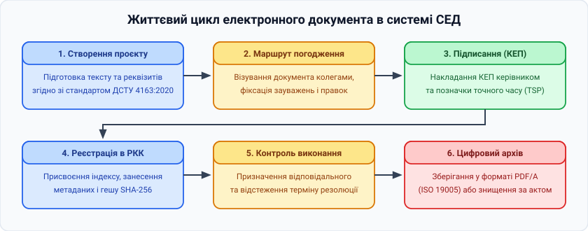
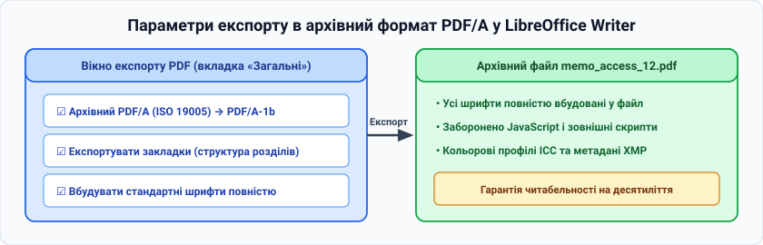

# Урок 52. Системи електронного документообігу

<div class="how-to">

**Як працювати з уроком**

1. Ознайомтеся з теоретичними положеннями законодавства України щодо електронних документів, принципами роботи КЕП та структурою систем електронного документообігу (СЕД).
2. Виконайте покрокове практичне завдання: створіть розпорядчий документ, експортуйте його в архівний формат PDF/A, перевірте метадані та протестуйте механізм контролю цілісності на основі криптографічного гешування.
3. Закріпіть навички у блоці **«Спробуйте самі»** та пройдіть контрольний тест із 10 запитань.

</div>

## Мета уроку

Ви дізнаєтеся, як функціонують сучасні системи електронного документообігу (СЕД / EDMS), які стандарти гарантують юридичну силу електронного документа та як забезпечується довготривале надійне зберігання цифрових архівів. На практиці ви:

- створите типовий службовий документ із дотриманням вимог національного стандарту діловодства ДСТУ 4163:2020;
- експортуєте документ у стандартизований міжнародний формат довготривалого архівного зберігання **PDF/A**;
- навчитеся досліджувати технічні метадані електронного файлу за допомогою консольних утиліт;
- зрозумієте роботу кваліфікованого електронного підпису (КЕП), навчитеся обчислювати криптографічні геш-суми SHA-256 для контролю незмінності документа та реєструвати документ у реєстраційно-контрольній картці (РКК).

## Що знадобиться

- Офісний пакет **LibreOffice** (програма LibreOffice Writer) для підготовки текстових документів та експорту в PDF/A.
- Сучасний веббраузер для доступу до сервісів перевірки КЕП (наприклад, [czo.gov.ua](https://czo.gov.ua) або [id.gov.ua/sign](https://id.gov.ua/sign)).
- Командний рядок Linux або Windows (утиліти `sha256sum`, `pdfinfo` або `certutil`).
- Текстовий редактор (nano, VS Code або блокнот) для реєстрації записів журналу.

## Теорія

### Електронний документ та нормативно-правова база

Відповідно до Закону України «Про електронні документи та електронний документообіг», **електронний документ** — це документ, інформація в якому зафіксована у вигляді електронних даних, включаючи обов’язкові реквізити документа.

Юридична сила електронного документа не може бути заперечена виключно через те, що він має електронну форму. Проте для надання документу статусу офіційного оригіналу він обов'язково повинен містити:
- реквізити автора (назва установи, посада, прізвище);
- дату створення та реєстраційний індекс;
- **кваліфікований електронний підпис (КЕП)** автора або особи, уповноваженої підписувати такі документи.

**Система електронного документообігу (СЕД / EDMS — Electronic Document Management System)** — це спеціалізований програмний комплекс, який автоматизує процеси створення, реєстрації, погодження, маршрутизації, контролю виконання, пошуку та архівного зберігання електронних документів підприємства.

<div class="clip">



*Життєвий цикл електронного документа в системі електронного документообігу (СЕД)*

</div>

### Кваліфікований електронний підпис (КЕП)

КЕП базується на технології **асиметричної криптографії** та інфраструктурі відкритих ключів (PKI — Public Key Infrastructure). Він використовує пару пов'язаних математичних ключів:
1. **Особистий (закритий) ключ:** зберігається виключно у власника на захищеному захищеному носії (токен, смарткарта, хмарний захищений криптомодуль HSM або файл-контейнер). Використовується для генерації електронного підпису.
2. **Відкритий ключ:** доступний будь-якій особі для перевірки підпису. Він публікується у формі **кваліфікованого сертифіката відкритого ключа** стандарту **X.509**, виданого акредитованим Кваліфікованим надавачем електронних довірчих послуг (КНЕДП).

Як формується КЕП:
1. За допомогою математичного алгоритму (наприклад, **SHA-256**) від вмісту документа обчислюється унікальний фіксований числовий зліпок — **геш (hash)**.
2. Цей геш шифрується за допомогою особистого закритого ключа підписувача. Результат шифрування і є цифровим підписом.
3. Під час перевірки система розшифровує підпис за допомогою відкритого ключа підписувача та порівнює отриманий геш із заново обчисленим гешем документа. Якщо хоча б один символ або пробіл у документі змінено, геші не співпадуть, і підпис буде визнано недійсним.

КЕП забезпечує три фундаментальні властивості:
- **Цілісність:** гарантія того, що документ не зазнав змін після підписання.
- **Автентичність (ідентифікація автора):** точне підтвердження особи підписувача через сертифікат.
- **Невідмовність (Non-repudiation):** автор не може заперечити факт підписання документа.

### Реєстраційно-контрольна картка (РКК)

Головним структурним елементом обліку в СЕД є **реєстраційно-контрольна картка (РКК)**. Вона містить метадані про документ:
- реєстраційний індекс (номер за номенклатурою справ);
- дату реєстрації;
- кореспондента (від кого надійшов або кому адресований);
- заголовок / короткий зміст;
- резолюцію керівника та термін виконання;
- відповідального виконавця;
- статус виконання («На погодженні», «В роботі», «Виконано», «До справи»).

### Формат PDF/A для довготривалого зберігання

Звичайний формат PDF може містити посилання на зовнішні шрифти, мультимедійні вставки або скрипти JavaScript, які через 10–20 років можуть не підтримуватися новими комп'ютерами. Для офіційного електронного архіву використовується міжнародний стандарт **PDF/A (ISO 19005)**.

Вимоги стандарту PDF/A:
- обов'язкове повне вбудовування всіх використаних шрифтів у файл;
- заборона виконання коду JavaScript, запуску виконуваних модулів та аудіо/відео;
- використання апаратно-незалежних кольорових профілів (ICC DeviceRGB, DeviceCMYK);
- обов'язкова наявність стандартизованих метаданих у форматі XMP (Extensible Metadata Platform).

<div class="more-link">

**Хочете знати більше?** <span class="optional">Необов’язково</span>

Під час підписання критично важливих документів окрім самого підпису додається **позначка точного часу (Timestamp, TSP)**. Позначка часу генерується спеціальним сервером довіреного часу (Time Stamping Authority) і доводить, що підпис було створено в конкретну секунду, коли сертифікат підписувача був чинним і не був відкликаний. Для перевірки статусу сертифікатів у реальному часі використовуються протокол **OCSP (Online Certificate Status Protocol)** та списки відкликаних сертифікатів **CRL (Certificate Revocation List)**.

</div>

## Покроково

Виконаємо практичну роботу оператора: створимо офіційний документ за правилами діловодства, збережемо його в надійному архівному форматі PDF/A, проаналізуємо метадані та перевіримо цілісність через криптографічний геш.

### 1. Створіть офіційну службову записку в LibreOffice Writer

1. Запустіть текстовий процесор **LibreOffice Writer**.
2. Встановіть розмір сторінки А4, стандартні поля: ліве — 30 мм, праве — 10 мм, верхнє та нижнє — по 20 мм.
3. Наберіть текст службової записки про надання прав доступу до корпоративного сервера:

```text
                                        Директору ТОВ "ТехноПром"
                                        Сергію КОВАЛЕНКУ
                                        
                                        оператора комп'ютерного набору
                                        Олексія МЕЛЬНИКА

СЛУЖБОВА ЗАПИСКА
16.11.2024  № 12-СЗ

Про надання доступу до файлового сервера

Прошу надати доступ до спільного мережевого каталогу "Accounting_Archive" 
на файловому сервері srv-storage.corp оператору Мельнику О. В. 
для виконання обов'язків з резервного копіювання документації підприємства.

Оператор з обробки інформації                 Олексій МЕЛЬНИК
```

### 2. Експортуйте файл у стандартизований формат PDF/A

1. У меню LibreOffice оберіть: **Файл -> Експорт як -> Експорт у PDF...** (File -> Export As -> Export as PDF).
2. На вкладці **Загальні (General)** знайдіть блок «Структура» та позначте прапорець **PDF/A (ISO 19005)**.
3. У випадному списку виберіть версію **PDF/A-1b** або **PDF/A-2b** (базовий рівень візуальної сумісності).
4. Натисніть кнопку **Експорт** і збережіть файл під назвою `memo_access_12.pdf`.

<div class="clip">



*Параметри експорту в архівний формат PDF/A у LibreOffice Writer*

</div>

### 3. Дослідіть метадані створеного документа через термінал

Відкрийте командний рядок у каталозі з файлом. Якщо встановлено пакет `poppler-utils`, скористайтеся утилітою `pdfinfo`:

```bash
pdfinfo memo_access_12.pdf
```

У виведеному звіті зверніть увагу на поля:
- `PDF version`: версія стандарту (наприклад, `1.4` для PDF/A-1).
- `Creator`: назва програми (`Writer`).
- `Producer`: бібліотека генерації документа (`LibreOffice`).
- `CreationDate`: точна дата та час формування файлу.

### 4. Обчисліть криптографічний геш документа (контроль цілісності)

Для підтвердження того, що електронний документ не підроблено і не пошкоджено під час передачі мережею, оператор фіксує його контрольний зліпок за алгоритмом SHA-256:

```bash
sha256sum memo_access_12.pdf
```

Термінал виведе 64-символьний шістнадцятковий рядок та ім'я файлу, наприклад:
```text
e3b0c44298fc1c149afbf4c8996fb92427ae41e4649b934ca495991b7852b855  memo_access_12.pdf
```

Зафіксуйте перші та останні 6 символів цього гешу — вони є унікальним цифровим ідентифікатором змісту документа.

### 5. Зареєструйте документ в електронній картці РКК

Створіть текстовий файл `registry_log.csv`, що моделює журнал реєстрації документів у СЕД підприємства:

```csv
reg_number,reg_date,doc_type,title,author,sha256_hash,status
"12-СЗ","2024-11-16","Службова записка","Доступ до сховища архіву","Мельник О. В.","e3b0c442...b855","Зареєстровано"
```

Коли документ надходить на погодження або підписання директору, електронна система автоматично звіряє розрахований геш із записаним у картці.

<div class="try">

**Спробуйте самі**

Переконайтеся на практиці у властивості **«лавинного ефекту»** криптографічного гешування.
1. Зробіть копію створеного PDF-файлу під назвою `memo_tampered.pdf`:
```bash
cp memo_access_12.pdf memo_tampered.pdf
```
2. Відкрийте копію у звичайному текстовому редакторі (наприклад, `nano memo_tampered.pdf`) або відредагуйте текст документа у LibreOffice (додайте хоча б одну крапку) і збережіть.
3. Обчисліть геш-суму обох файлів за допомогою команди:
```bash
sha256sum memo_access_12.pdf memo_tampered.pdf
```

<details>
<summary>Перевірити очікуваний результат і повний розв’язок</summary>

**Очікуваний результат у терміналі:**
Хеш-суми обох файлів будуть **кардинально різними**, незважаючи на зміну лише одного символу:

```text
e3b0c44298fc1c149afbf4c8996fb92427ae41e4649b934ca495991b7852b855  memo_access_12.pdf
7f83b1657ff1fc53b92dc18148a1d65dfc2d4b1fa3d677284addd200126d9069  memo_tampered.pdf
```

**Висновок для оператора:**
Це наочно демонструє, чому електронний документ із накладеним КЕП неможливо непомітно підробити. Якщо зловмисник спробує змінити хоча б одну цифру в рахунку чи номер наказу, математична перевірка підпису миттєво поверне статус `«Помилка: цілісність документа порушена, підпис недійсний»`.

</details>

</div>

## Підсумок

- **Електронний документ** має повну юридичну силу за наявності обов'язкових реквізитів та накладеного кваліфікованого електронного підпису (КЕП).
- **КЕП** базується на асиметричній криптографії (закритий ключ для підпису, відкритий сертифікат для перевірки) і гарантує цілісність та авторство документа.
- **Реєстраційно-контрольна картка (РКК)** є основним інструментом оператора для обліку, маршрутизації та контролю термінів виконання документів у СЕД.
- Міжнародний стандарт **PDF/A** вимагає повного вбудовування шрифтів та заборони динамічних сценаріїв, що гарантує читабельність електронного архіву через десятиліття.

## Тест

<div class="test-box">

10 запитань за матеріалом уроку. На початку тесту вкажіть **прізвище, ім’я та групу**.

🔗 <!-- GOOGLE_FORM_URL:lesson-52 --> *(Посилання на Google Форму буде додано після масового імпорту тесту)*

</div>

## Додаткове завдання

<span class="optional">Необов’язково</span> Виконуйте для закріплення навичок роботи з електронними довірчими послугами.

**Базовий рівень.** Зайдіть на офіційний вебпортал Центрального засвідчувального органу України ([czo.gov.ua/verify](https://czo.gov.ua/verify)) або [id.gov.ua/sign](https://id.gov.ua/sign). Ознайомтеся з інтерфейсом онлайн-перевірки електронного підпису. Завантажте будь-який публічно доступний підписаний файл (наприклад, тестовий документ із підписом або квитанцію з банку) та перегляньте дані сертифіката (ким виданий, термін дії, серійний номер).

**Проєктний рівень.** Розробіть схему руху службової записки на придбання нового принтера в установі. Вкажіть ланцюжок погодження: від автора (оператора) через начальника відділу та головного бухгалтера до директора. Опишіть, які статуси змінює документ у РКК на кожному етапі та що відбувається у разі відхилення документа одним із підписантів.
