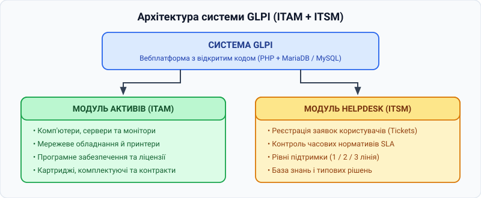
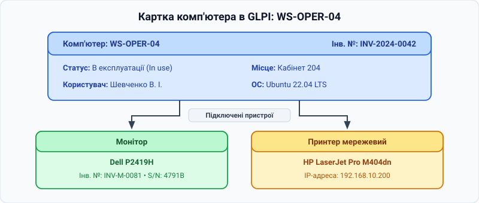

# Урок 53. Системи обліку заявок та інвентаризації обладнання (GLPI)

<div class="how-to">

**Як працювати з уроком**

1. Ознайомтеся з концепціями управління ІТ-активами (ITAM) та стандартами служби технічної підтримки (Service Desk / Helpdesk) на базі системи з відкритим кодом GLPI.
2. Виконайте покрокове практичне завдання: зберіть технічну конфігурацію комп'ютера, сформуйте інвентарну картку обладнання та опрацюйте інцидент техпідтримки з дотриманням нормативів угоди SLA.
3. Закріпіть навички у блоці **«Спробуйте самі»** та пройдіть контрольний тест із 10 запитань.

</div>

## Мета уроку

Ви дізнаєтеся, як системні адміністратори та оператори з обробки інформації контролюють парк комп'ютерної техніки підприємства, ведуть облік витратних матеріалів (картриджів, кабелів, накопичувачів) і своєчасно усувають неполадки за зверненнями користувачів. На практиці ви:

- навчитеся збирати детальні відомості про апаратне та програмне забезпечення робочої станції за допомогою утиліт командного рядка;
- структуруєте дані для картки активу (Asset) з прив'язкою серійних номерів, комплектуючих, кабінетів та матеріально відповідальних осіб;
- засвоїте логіку функціонування модуля Helpdesk: реєстрація звернення, призначення пріоритету та виконавця, маршрутизація тікета;
- зафіксуєте технічне рішення та закриєте заявку відповідно до стандартів ІТ-обслуговування.

## Що знадобиться

- Веббраузер для взаємодії з інтерфейсом системи GLPI (офіційний демонстраційний стенд [glpi-project.org](https://glpi-project.org) або локальний тестовий сервер).
- Робоча станція під управлінням Linux або Windows із доступом до терміналу (`lshw`, `lscpu`, `free`, `lsblk`, `ip link` у Linux або `msinfo32`, `wmic`, PowerShell у Windows).
- Текстовий або табличний процесор (LibreOffice Calc) для заповнення паспорта робочого місця.

## Теорія

### Проблема хаотичного обліку та концепція ITAM

У компаніях, де працюють десятки або сотні співробітників, без автоматизованого обліку неминуче виникає «зоопарк» техніки. Комп'ютери переносять між відділами без відома адміністраторів, пам'ять та диски губляться або самовільно замінюються, ліцензії на дороге програмне забезпечення купуються повторно або встановлюються нелегально, а ремонт принтерів затягується на тижні.

Для розв'язання цих проблем використовують концепцію **ITAM (IT Asset Management — управління ІТ-активами)**:
- **Апаратні активи:** системні блоки, моноблоки, ноутбуки, монітори, сервери, мережеві комутатори, Wi-Fi точки, принтери та БФП.
- **Програмні активи:** операційні системи, офісні пакети, спеціалізовані САПР та графічні редактори, антивіруси, терміни дії ліцензійних ключів.
- **Витратні матеріали та комплектуючі:** тонер-картриджі, патч-корди, миші, клавіатури, планки оперативної пам'яті, запасні SSD.

### Можливості системи GLPI

**GLPI (Gestionnaire Libre de Parc Informatique)** — це потужна інформаційна система з відкритим кодом (Open Source) на базі стеку PHP та MariaDB/MySQL, яка поєднує в собі повноцінне управління ІТ-активами (ITAM) та автоматизовану службу технічної підтримки (**Service Desk / Helpdesk**) відповідно до найкращих світових практик бібліотеки **ITIL (Information Technology Infrastructure Library)**.

Основні функціональні модулі GLPI:
1. **Облік обладнання (Assets / Парк):** паспорти техніки з історією переміщень, підключеними моніторами, встановленими програмами та журналами ремонтів.
2. **Helpdesk / Тікети (Assistance / Підтримка):** прийом заявок від користувачів електронною поштою, через вебкабінет або телефон оператора.
3. **Управління ліцензіями:** облік кількості куплених ліцензій та реальної кількості їх встановлень на комп'ютерах.
4. **Управління контрактами та постачальниками:** контроль гарантійних термінів техніки, договорів на інтернет та сервісне обслуговування.
5. **База знань (Knowledge Base):** накопичення інструкцій та типових рішень найчастіших проблем користувачів.

<div class="clip">



*Архітектура системи GLPI: модулі управління активами (ITAM) та служби підтримки Helpdesk (ITSM)*

</div>

### Автоматичний збір даних: GLPI Agent

Вносити параметри сотень комп'ютерів вручну довго й небезпечно через ризик описок. Для цього використовується **GLPI Agent** — спеціальна службова програма, яка встановлюється на кожен робочий комп'ютер (під Linux, Windows або macOS).

Як працює агент:
1. Агент сканує материнську плату та шини через інтерфейси **DMI / SMBIOS** та **WMI**, зчитує точні моделі процесора, материнської плати, тип і серійні номери планок RAM, SMART-статус дисків, MAC-адреси мережевих карт та перелік установлених додатків із системного реєстру або пакетного менеджера (APT/RPM).
2. Формує структурований звіт у форматі XML або JSON.
3. Відправляє його через захищений протокол HTTPS до сервера GLPI.
4. Сервер автоматично оновлює конфігурацію відповідного комп'ютера або створює новий запис. Якщо оператор замінив планку пам'яті з 8 ГБ на 16 ГБ, у картці GLPI з'явиться відповідний запис в історії змін.

### Робота служби Helpdesk: Інциденти та SLA

Будь-яке звернення до служби підтримки фіксується як **тікет (Ticket / Заявка)**.
- **Інцидент (Incident):** незаплановане переривання або зниження якості ІТ-послуги (наприклад: зник інтернет, перестав друкувати принтер, не вмикається монітор).
- **Запит на обслуговування (Service Request):** планова послуга, яка не є збоєм (наприклад: прохання встановити архіватор, виділити новий монітор, створити корпоративну пошту для новачка).

**SLA (Service Level Agreement — угода про рівень послуг)** визначає обов'язкові часові межі для роботи над заявкою:
- **Час першої реакції:** максимальний час від появи заявки до взяття її оператором у роботу (наприклад, 15 хвилин для критичних інцидентів).
- **Час вирішення:** максимальний час до повного відновлення працездатності (наприклад, 2 години для збою бухгалтерії, 24 години для планової заміни миші).

<div class="more-link">

**Хочете знати більше?** <span class="optional">Необов’язково</span>

У великих корпоративних мережах GLPI вміє виконувати **мережеве виявлення (Network Discovery)** через протокол **SNMP (Simple Network Management Protocol)**. Сервер без будь-яких агентів сканує локальні підмережі, самостійно опитує мережеві комутатори Cisco чи MikroTik, зчитує таблицю комутації MAC-адрес (CAM-таблицю) і автоматично будує інтерактивну карту того, до якого саме фізичного порту якого комутатора підключено комп'ютер кожного оператора.

</div>

## Покроково

Виконаємо практичну роботу оператора комп'ютерного набору: зберемо апаратні характеристики власного робочого місця, оформимо картку активу та проведемо через систему інцидент збою друку.

### 1. Зберіть технічні дані комп'ютера за допомогою системних утиліт

Відкрийте термінал та виконайте команди для визначення ключових показників системи:

```bash
# 1. Мережеве ім'я комп'ютера
hostname

# 2. Модель процесора та кількість ядер
lscpu | grep -E "Model name|CPU\(s\):"

# 3. Обсяг оперативної пам'яті
free -h | grep "Mem:"

# 4. Модель та ємність дисків
lsblk -d -o NAME,SIZE,MODEL,ROTA

# 5. Фізична (MAC) адреса мережевого адаптера
ip link show | grep -E "link/ether"
```

Для користувачів Windows аналогічну інформацію можна отримати через команду `msinfo32` або у PowerShell:
```powershell
Get-CimInstance Win32_ComputerSystem | Select-Object Name, TotalPhysicalMemory, Model
Get-CimInstance Win32_Processor | Select-Object Name, NumberOfCores
```

### 2. Сформуйте картку технічного паспорта робочої станції

На основі отриманих даних оператор складає специфікацію для внесення в систему інвентаризації:

| Параметр | Значення для внесення в GLPI |
| :--- | :--- |
| **Інвентарний номер** | `INV-2024-0042` |
| **Назва активу (Name)** | `WS-OPER-04` |
| **Серійний номер (S/N)** | `CZC8349K12` |
| **Тип обладнання** | Робоча станція (Desktop PC) |
| **Статус життєвого циклу** | В експлуатації (In use) |
| **Процесор** | Intel Core i5-11400 (6 ядер, 2.6–4.4 ГГц) |
| **Оперативна пам'ять** | 16 ГБ DDR4-3200 (2 × 8 ГБ Kingston) |
| **Накопичувач** | SSD 512 ГБ NVMe Kingston SNV2S |
| **Мережева адреса / MAC** | `192.168.10.42` / `bc:24:11:45:9a:10` |
| **Розташування (Location)** | Головний корпус, 2-й поверх, каб. 204 |
| **Відповідальна особа** | Оператор ІТ Шевченко В. І. |

### 3. Зареєструйте обладнання у вебінтерфейсі GLPI

1. Увійдіть у GLPI з правами техніка чи оператора (`glpi / glpi` на тестових стендах).
2. У головному меню перейдіть: **Парк (Assets) -> Комп'ютери (Computers)**.
3. Натисніть кнопку **«Додати» (+ / Add)**.
4. Заповніть обов'язкові поля:
   - **Назва:** `WS-OPER-04`
   - **Статус:** `В експлуатації`
   - **Розташування:** `Кабінет 204`
   - **Технік:** оберіть власне ім'я
   - **Інвентарний номер:** `INV-2024-0042`
5. Натисніть **«Зберегти» (Add)**.
6. У лівому бічному меню картки комп'ютера перейдіть на вкладку **Компоненти (Components)** та прив'яжіть обсяг оперативної пам'яті (16 ГБ) та жорсткий диск (SSD 512 ГБ).
7. На вкладці **Монітори** натисніть «Підключити монітор» та додайте службовий монітор `Dell P2419H (S/N: 4791B)`.

<div class="clip">



*Інвентарна картка комп'ютера WS-OPER-04 в системі GLPI з підключеним монітором і мережевим принтером*

</div>

### 4. Оформіть та опрацюйте інцидент у модулі Helpdesk

1. Перейдіть до меню **Підтримка (Assistance) -> Заявки (Tickets) -> Створити заявку (+)**.
2. Заповніть реквізити звернення:
   - **Тип:** `Інцидент`
   - **Категорія:** `Апаратне забезпечення / Принтери`
   - **Джерело запиту:** `Телефон`
   - **Заявник (Requester):** `Бухгалтер Іванова О. П.`
   - **Елемент обладнання (Item):** оберіть комп'ютер `WS-OPER-04` або принтер відділу.
   - **Терміновість (Urgency):** `Висока` (зупинено друк податкових звітів).
   - **Тема:** `Мережевий принтер не приймає завдання на друк`.
   - **Опис:** `При спробі відправити документ на друк принтер HP M404dn видає повідомлення "Помилка зв'язку". Індикатор мережі на задній панелі не світиться.`
3. Натисніть **«Додати» (Add)**. Тікет отримає номер `#000108` та статус **«Новий»**.

### 5. Призначте виконавця, зафіксуйте діагностику та закрийте заявку

1. Відкрийте заявку `#000108`. Змініть статус на **«В обробці (призначено)»** та вкажіть себе виконавцем.
2. У розділі дій натисніть **«Додати завдання» (Add Task)**:
   - Текст завдання: *«Виконано фізичну перевірку кабелю живлення та витої пари. Виявлено пошкодження конектора RJ-45 патч-корду. Проведено переобтискання кабелю за стандартом T568B.»*
3. Натисніть кнопку **«Додати розв'язання» (Add Solution)**:
   - Тип рішення: *«Заміна / ремонт комутаційного обладнання»*.
   - Опис: *«Конектор RJ-45 замінено, мережевий лінк 1000 Мбіт/с відновлено. Виконано тестовий друк сторінки конфігурації. Принтер працює у штатному режимі.»*
4. Статус заявки перейде в стан **«Вирішено» (Solved)**. Користувач отримує сповіщення електронною поштою та підтверджує успішне виконання, після чого статус стає **«Закрито» (Closed)**.

<div class="try">

**Спробуйте самі**

Розрахуйте дотримання нормативу SLA за такими даними:
- Заявка з пріоритетом «Дуже високий» (Very High) надійшла до системи о **09:40**.
- Згідно з регламентом SLA установи: час реакції — до **20 хвилин**, максимальний час вирішення — до **90 хвилин**.
- Оператор зареєстрував призначення заявки о **09:52**, а статус «Вирішено» було зафіксовано об **11:05**.

Чи було порушено норматив SLA (час реакції та час вирішення)?

<details>
<summary>Перевірити очікуваний результат і повний розв’язок</summary>

**Аналіз часових інтервалів:**
1. **Час першої реакції:**
   - 09:52 − 09:40 = 12 хвилин.
   - Оскільки 12 хв < 20 хв, норматив часу реакції **виконано успішно** (без запізнення).
2. **Час повного вирішення інциденту:**
   - Від 09:40 до 11:05 минуло: 1 година 25 хвилин = **85 хвилин**.
   - Оскільки 85 хв ≤ 90 хв (граничний ліміт за SLA), інцидент вирішено вчасно.

**Висновок для оператора:**
Обидва показники угоди про рівень послуг дотримано. У звіті аналітики GLPI заявка відобразиться зеленим кольором (SLA Met), а оцінка якості сервісу не знизиться.

</details>

</div>

## Підсумок

- Система **GLPI** є єдиним центром координації між технічною службою підприємства, комп'ютерним парком та користувачами.
- **ITAM (управління активами)** дозволяє вести точний облік комплектуючих, прив'язувати техніку до співробітників і кабінетів та контролювати наявність ліцензій на ПЗ.
- **GLPI Agent** автоматизує процес інвентаризації, зчитуючи низькорівневі характеристики «заліза» через інтерфейси DMI/WMI та оновлюючи базу без ручної рутини.
- Обробка інцидентів у модулі **Helpdesk** вимагає чіткої фіксації життєвого циклу тікета: реєстрація, пріоритет, терміни SLA, опис дій техніка та фіксація перевіреного рішення.

## Тест

<div class="test-box">

10 запитань за матеріалом уроку. На початку тесту вкажіть **прізвище, ім’я та групу**.

<!-- GOOGLE_FORM_START:lesson-53 -->
[Відкрити тест у новій вкладці](https://docs.google.com/forms/d/e/1FAIpQLSd3Zsl2VjgiIya-4Fu_ZpWQseSKIRMPBhLfsC3f1djwqO_E9A/viewform)

<iframe src="https://docs.google.com/forms/d/e/1FAIpQLSd3Zsl2VjgiIya-4Fu_ZpWQseSKIRMPBhLfsC3f1djwqO_E9A/viewform?embedded=true" loading="lazy" title="Тест lesson-53">Завантаження…</iframe>
<!-- GOOGLE_FORM_END:lesson-53 -->

</div>

## Додаткове завдання

<span class="optional">Необов’язково</span> Виконуйте для закріплення навичок ІТ-інвентаризації.

**Базовий рівень.** За допомогою системних команд своєї операційної системи (`lshw -short` у Linux або `Get-WmiObject win32_logicaldisk` у Windows PowerShell) виведіть список усіх логічних розділів накопичувача, їх файлові системи та вільне місце. Запишіть отримані дані у форматі технічного звіту для картки GLPI.

**Проєктний рівень.** Складіть шаблон регламенту прийому заявок технічної підтримки для комп'ютерного класу ліцею. Розподіліть 4 типові проблеми за пріоритетами (Низький, Середній, Високий, Критичний): 1) заміна батарейки в бездротовій миші викладача; 2) збій головного маршрутизатора доступу до інтернету під час ЗНО; 3) вихід з ладу одного монітора в класі з 15 ПК; 4) закінчення тонера в принтері навчальної частини. Вкажіть бажаний нормативний час вирішення (SLA) для кожної ситуації.
