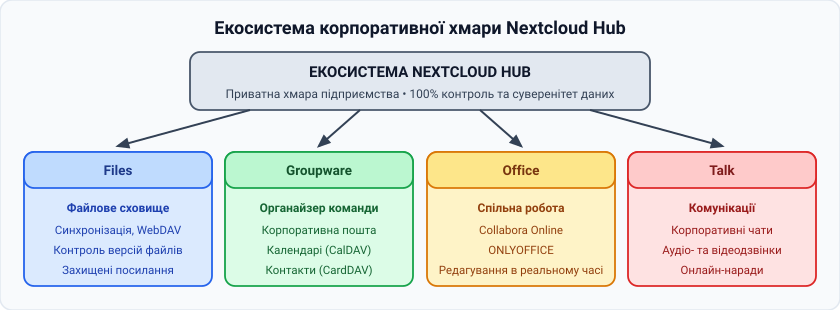
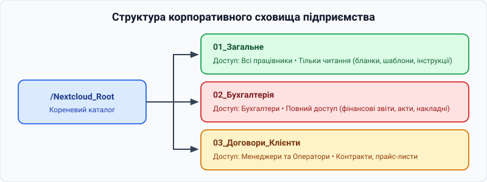

# Урок 54. Хмарні інформаційні системи (Nextcloud)

<div class="how-to">

**Як працювати з уроком**

1. Ознайомтеся з відмінностями між публічними та приватними хмарними платформами, вивчіть можливості платформи Nextcloud та призначення протоколів WebDAV, CalDAV і CardDAV.
2. Виконайте покрокове практичне завдання: побудуйте структуру каталогів відділів підприємства, налаштуйте обмеження прав спільного доступу, підключіть сховище через WebDAV та протестуйте систему контролю версій.
3. Закріпіть навички у блоці **«Спробуйте самі»** та пройдіть контрольний тест із 10 запитань.

</div>

## Мета уроку

Ви дізнаєтеся, як сучасні підприємства забезпечують захищений спільний доступ до цифрових документів без передачі конфіденційних комерційних даних стороннім глобальним корпораціям. На практиці ви:

- навчитеся проєктувати логічну структуру папок корпоративного сховища з урахуванням розмежування прав доступу груп співробітників;
- опануєте налаштування безпеки спільних посилань (парольний захист, заборона завантаження, термін придатності посилання);
- навчитеся підключати хмарний диск до операційної системи через універсальний мережевий протокол **WebDAV** за допомогою командного рядка;
- протестуєте механізм версійності (File Versioning) та навчитеся відновлювати важливі документи після помилкових правок чи видалення.

## Що знадобиться

- Веббраузер для адміністрування та роботи в хмарному інтерфейсі Nextcloud (публічний демосервер [try.nextcloud.com](https://try.nextcloud.com) або локальний екземпляр у Docker чи віртуальній машині).
- Термінал Linux або командний рядок Windows з утилітою `curl` або підтримкою мережевого клієнта WebDAV (`davfs2` у Linux або команда `net use` у Windows).
- Офісний текстовий або табличний процесор (LibreOffice або вбудований текстовий редактор Nextcloud).

## Теорія

<div class="clip">


*Зберігання та обробка структурованих даних<sup>[1]</sup>*

</div>

### Публічні vs Приватні хмари: проблема суверенітету даних

Більшість користувачів знайомі з публічними хмарними сервісами: Google Drive, Microsoft OneDrive, Dropbox чи iCloud. Проте для комерційних підприємств, фінансових установ, медичних закладів та державних органів використання публічних хмар несе суттєві ризики:
- **Загроза витоку комерційної таємниці:** дані фізично зберігаються на серверах іноземних провайдерів під юрисдикцією інших держав.
- **Вимоги законодавства (GDPR, Закон України «Про захист персональних даних»):** персональні дані клієнтів та працівників заборонено передавати несертифікованим іноземним серверам.
- **Фінансова залежність від ліцензій:** щомісячна абонентська плата за кожного співробітника значно збільшує бюджет компанії.

Рішенням є **приватна хмара (Self-hosted Private Cloud)**, розгорнута на власних серверах підприємства або у надійному національному дата-центрі.

**Nextcloud** — це найпопулярніша у світі платформа з відкритим кодом для створення корпоративного приватного хмарного сховища. Вона забезпечує 100% контроль над інформацією: системні адміністратори знають точне місцезнаходження кожного байта даних і керують усіма рівнями безпеки.

<div class="clip">



*Екосистема корпоративної приватної хмари Nextcloud Hub: модулі Files, Groupware, Office та Talk*

</div>

### Архітектура платформи Nextcloud

Nextcloud побудовано за класичною серверною трирівневою архітектурою:
1. **Вебсервер:** Nginx або Apache з увімкненим модулем безпеки SSL/TLS (HTTPS).
2. **Програмна логіка:** мова програмування **PHP** (версії 8.1+) з оптимізацією через кешувальний сервер **Redis** або Memcached для прискорення транзакцій блокування файлів.
3. **База даних:** реляційна СУБД **PostgreSQL** або **MariaDB/MySQL**, де зберігаються метадані: облікові записи, зв'язки папок, права доступу, мітки та історія дій.
4. **Файлове сховище (Storage):** локальні RAID-масиви сервера, мережеві сховища NFS або об'єктні сховища S3 (MinIO).

### Протокол WebDAV: хмара як мережевий диск

Однією з найпотужніших можливостей Nextcloud є підтримка відкритого стандарту **WebDAV (Web Distributed Authoring and Versioning)** — розширення протоколу HTTP/1.1 (RFC 4918), призначеного для спільного створення та редагування файлів на віддаленому сервері.

Спеціальні команди протоколу WebDAV:
- `PROPFIND` — отримання властивостей файлу або списку файлів у каталозі (аналог команди `ls` або `dir`).
- `MKCOL` — створення нової колекції (каталогу, аналог `mkdir`).
- `COPY` та `MOVE` — копіювання та переміщення файлів на сервері без їх попереднього завантаження на локальний комп'ютер.
- `LOCK` та `UNLOCK` — блокування файлу на час редагування одним користувачем для запобігання конфліктам збереження іншими працівниками.

Завдяки WebDAV оператор може підключити віддалене хмарне сховище безпосередньо у вікно «Мій комп'ютер» у Windows чи файловий менеджер Nautilus у Linux, працюючи з файлами так само зручно, як і зі звичайною флешкою.

### Безпека та керування доступом

Оператор з обробки інформації в Nextcloud використовує розширені політики доступу:
1. **Дискові квоти:** обмеження максимального обсягу (наприклад, 10 ГБ для стажиста, без обмежень для резервних копій).
2. **Рівні доступу до папок:** «Повний доступ», «Тільки читання», «Створення без читання (File Drop — анонімна скринька для завантаження файлів клієнтами)».
3. **Безпека публічних посилань:**
   - захист посилання складним паролем;
   - встановлення терміну дії (наприклад, посилання автоматично анулюється через 7 днів);
   - заборона скачування («Hide download» — доступний лише захищений перегляд у браузері без можливості збереження на диск).
4. **Контроль версій (File Versioning):** автоматичне створення знімка стану файлу під час кожного збереження. Якщо користувач видалив таблицю або випадково зіпсував звіт, попередню версію можна відновити одним кліком.

<div class="more-link">

**Хочете знати більше?** <span class="optional">Необов’язково</span>

Платформа Nextcloud підтримує інтеграцію офісних пакетів для спільного редагування в режимі реального часу — **Collabora Online** (на ядрі LibreOffice) та **ONLYOFFICE**. Коли двоє або більше операторів одночасно відкривають один і той самий документ DOCX або таблицю XLSX, вони бачать курсори одне одного, виділені різними кольорами, а зміни зберігаються на льоту без виникнення конфліктних копій файлів.

</div>

## Покроково

Виконаємо практичну роботу оператора: структуруємо сховище малого підприємства, надамо захищений доступ для контрагента, протестуємо команди протоколу WebDAV та відновимо документ через систему версійності.

### 1. Створіть логічну ієрархію каталогів компанії

1. Увійдіть до системи Nextcloud під своїм обліковим записом.
2. У верхньому меню перейдіть у розділ **Файли (Files)**.
3. Натисніть кнопку **«+» (Створити)** та створіть три папки:
   - `01_Загальне` — загальнодоступні бланки, шаблони заяв, інструкції.
   - `02_Бухгалтерія` — фінансові звіти, акти, видаткові накладні.
   - `03_Договори_Клієнти` — комерційні пропозиції та скан-копії контрактів.

<div class="clip">



*Структура корпоративного сховища підприємства у Nextcloud з розмежуванням прав доступу*

</div>

### 2. Налаштуйте публічний захищений доступ до комерційної папки

Уявіть завдання: необхідно передати каталог із прайс-листами аудиторській компанії, забезпечивши конфіденційність.

1. У каталозі `03_Договори_Клієнти` створіть підпапку `Прайс_2024`.
2. Натисніть на значок **«Поділитися» (Share icon)** праворуч від папки.
3. У бічній панелі виберіть **«Посилання для спільного доступу» (Share link / +)**.
4. Розгорніть додаткові параметри захисту:
   - Встановіть прапорець **«Захистити паролем» (Password protect)** та введіть стійкий пароль: `Audit_Secure#2024`.
   - Встановіть прапорець **«Встановити термін дії» (Set expiration date)** та оберіть дату через 7 днів.
   - Виберіть рівень дозволів: **«Тільки перегляд» (Read only)** та позначте **«Приховати завантаження» (Hide download)**, щоб документ не можна було скопіювати на сторонній пристрій.
5. Скопіюйте згенероване посилання у буфер обміну.

### 3. Перевірте доступ через протокол WebDAV у командному рядку

Знайдіть адресу персональної точки підключення WebDAV. У вебінтерфейсі Nextcloud унизу лівої панелі натисніть **«Параметри файлів» (Files settings)** та скопіюйте URL, який має вигляд:
`https://<адреса_сервера>/remote.php/dav/files/<ім'я_користувача>/`

Відкрийте термінал Linux та виконайте запит опитування папки за допомогою утиліти `curl` (замініть облікові дані та адресу на свої):

```bash
curl -u admin:admin123 -X PROPFIND https://demo.nextcloud.com/remote.php/dav/files/admin/01_Загальне/
```

Сервер поверне XML-відповідь зі статусом `HTTP/1.1 207 Multi-Status`, переліком властивостей каталогу, його розміром та часом останньої модифікації.

Для створення нової папки через WebDAV без браузера введіть:
```bash
curl -u admin:admin123 -X MKCOL https://demo.nextcloud.com/remote.php/dav/files/admin/01_Загальне/Архіви_2023/
```

### 4. Створіть робочий документ та збережіть кілька правок

1. У папці `01_Загальне` натисніть **«+» -> «Текстовий документ» (New text document)** та назвіть його `Rules.md`.
2. Внесіть початковий текст (Версія 1):
```markdown
# Правила безпеки комп'ютерного кабінету
1. Забороняється підключати неперевірені особисті USB-флешки.
2. Наприкінці зміни оператор зобов'язаний вимкнути робочу станцію.
```
3. Зачекайте збереження документа, закрийте його.
4. Знову відкрийте `Rules.md` та додайте ще один пункт (Версія 2):
```markdown
3. Доступ до серверної шафи мають виключно чергові системні адміністратори.
```
5. Збережіть і закрийте файл.

### 5. Відновіть попередній стан файлу через механізм версійності

1. Натисніть на значок із трьома крапками біля файлу `Rules.md` та оберіть пункт **«Деталі» (Details)**.
2. У правій бічній панелі перейдіть на вкладку **«Версії» (Versions)**.
3. Ви побачите список збережених знімків файлу з точним часом їх створення та розміром.
4. Натисніть кнопку зі стрілкою **«Відновити» (Restore)** навпроти найпершої версії.
5. Відкрийте файл — вміст миттєво повернувся до початкового варіанта з двома правилами.

<div class="try">

**Спробуйте самі**

Перевірте роботу механізму безпеки публічних посилань.
1. Відкрийте нове вікно браузера у приватному режимі (**Інкогніто** / `Ctrl + Shift + N`), де ви не авторизовані в системі Nextcloud.
2. Вставте скопійоване на кроці 2 посилання на папку `Прайс_2024`.
3. Спробуйте увійти з порожнім або неправильним паролем (`12345`). Що відповідає система?
4. Введіть правильний пароль `Audit_Secure#2024`. Перевірте, чи дозволяє інтерфейс редагувати документи або створювати нові файли в цій папці.

<details>
<summary>Перевірити очікуваний результат і повний розв’язок</summary>

**Очікуваний результат:**
- При введенні неправильного пароля сторінка оновлюється з червоним повідомленням про помилку: `«Невірний пароль» (Wrong password)`, доступ до переліку файлів повністю блокується.
- Після введення коректного пароля `Audit_Secure#2024` відкривається вміст каталогу `Прайс_2024`.
- Оскільки під час налаштування було вибрано обмеження **«Тільки перегляд» (Read only)**, кнопки «+» (Створити) та «Видалити» будуть відсутні.
- Якщо було активовано опцію **«Hide download»**, документи відображатимуться лише через онлайн-переглядач у захищеному фреймі без кнопки «Завантажити файл на диск».

</details>

</div>

## Підсумок

- **Nextcloud** забезпечує повний цифровий суверенітет підприємства, дозволяючи зберігати файли на власних підконтрольних серверах з дотриманням законодавства про захист інформації.
- Протокол **WebDAV** дає змогу підключати хмарне сховище як локальний мережевий диск до будь-якої операційної системи за допомогою стандартних засобів без встановлення сторонніх клієнтів.
- Гнучка система **спільного доступу (Sharing)** дозволяє захищати файли паролями, лімітувати термін придатності посилань та блокувати несанкціоноване завантаження.
- Функція **версійності (File Versioning)** захищає компанію від випадкової втрати даних, пошкодження файлів та наслідків некваліфікованих дій персоналу.

## Тест

<div class="test-box">

10 запитань за матеріалом уроку. На початку тесту вкажіть **прізвище, ім’я та групу**.

<!-- GOOGLE_FORM_START:lesson-54 -->
[Відкрити тест у новій вкладці](https://docs.google.com/forms/d/e/1FAIpQLSeV6VsrDdC1SY-f0VPncTFuiU5wHUGC8K28Meq0KIwV0z74AA/viewform)

<iframe src="https://docs.google.com/forms/d/e/1FAIpQLSeV6VsrDdC1SY-f0VPncTFuiU5wHUGC8K28Meq0KIwV0z74AA/viewform?embedded=true" loading="lazy" title="Тест lesson-54">Завантаження…</iframe>
<!-- GOOGLE_FORM_END:lesson-54 -->

</div>

## Додаткове завдання

<span class="optional">Необов’язково</span> Виконуйте для підвищення кваліфікації в адмініструванні хмарних сховищ.

**Базовий рівень.** За допомогою графічного інтерфейсу Nextcloud або налаштувань профілю створіть новий контакт у модулі «Контакти» (Contacts) та внесіть подію «Планова технічна нарада» у вбудований «Календар» (Calendar). Вкажіть, які мережеві протоколи використовуються для синхронізації контактів та календарів зі смартфонами (CardDAV та CalDAV).

**Проєктний рівень.** Опишіть політику розмежування прав доступу до хмарного сховища для невеликої друкарні (12 співробітників: Директор, Бухгалтерія — 2 особи, Дизайнери — 3 особи, Оператори друку — 6 осіб). Складіть таблицю з переліком папок, призначеними групами користувачів, правами (читання, запис, повний доступ) та дисковими квотами на кожного користувача.

## Джерела

1. [Database-icon.svg](https://commons.wikimedia.org/wiki/File:Database-icon.svg), Wikimedia Commons.
