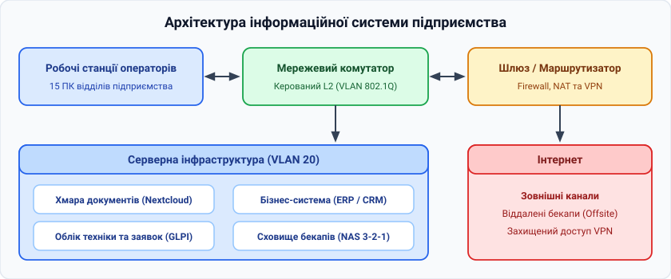
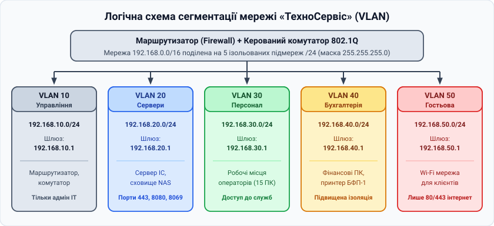

# Урок 55. Проєкт: конфігурація інформаційної системи невеликого підприємства

<div class="how-to">

**Як працювати з уроком**

1. Ознайомтеся з методологією комплексного проєктування комп'ютерних інформаційних систем для малого бізнесу та правилами розрахунку апаратно-програмних комплексів.
2. Виконайте покрокове практичне проєктне завдання: розробіть технічну специфікацію обладнання, складіть схему сегментації локальної мережі, сформуйте матрицю прав доступу та регламент резервного копіювання.
3. Закріпіть навички у блоці **«Спробуйте самі»** та пройдіть підсумковий контрольний тест із 10 запитань.

</div>

## Мета уроку

Ви перейдете від вивчення окремих служб та програм до системного інженерного мислення — розробки цілісного проєкту інформаційної системи (ІС) підприємства, що поєднує апаратне забезпечення, мережеву інфраструктуру, серверні служби, бізнес-додатки та систему безпеки. На практиці ви:

- навчитеся аналізувати потреби реального підприємства та формувати технічне завдання (ТЗ);
- підберете специфікацію апаратного забезпечення (сервери, робочі станції операторів, активне мережеве обладнання, джерела безперебійного живлення);
- розробите логічну схему локальної мережі з розподілом за віртуальними підмережами (VLAN) та таблицею IP-адресації;
- спроєктуєте програмний стек (ОС, Nextcloud, GLPI, Dolibarr/Odoo, СЕД) і матрицю доступу для персоналу;
- створите регламент захисту інформації та резервного копіювання за «золотим правилом 3-2-1».

## Що знадобиться

- Табличний процесор (LibreOffice Calc) для складання кошторису специфікації обладнання та таблиць IP-адресації.
- Текстовий процесор (LibreOffice Writer) для оформлення пояснювальної записки проєкту за ДСТУ.
- Інструмент побудови схем (онлайн-сервіс Draw.io / diagrams.net або оффлайн-редактор) для візуалізації топології мережі.
- Калькулятор або командний рядок для інженерних розрахунків потужності електроживлення.

## Теорія

### Системний підхід до побудови ІС

Для кваліфікованого оператора з обробки інформації та програмного забезпечення побудова інформаційної системи — це не просто купівля кількох системних блоків. Це створення надійного, масштабованого та безпечного середовища, у якому всі елементи злагоджено взаємодіють між собою.

Етапи життєвого циклу створення ІС:
1. **Передпроєктне обстеження:** аналіз кількості робочих місць, розташування кабінетів, характеру завдань (офісні документи, графіка, бази даних), наявності каналів зв'язку.
2. **Формування Технічного завдання (ТЗ):** юридично обов'язковий документ, що фіксує вимоги до надійності, швидкодії, безпеки та бюджету системи.
3. **Проєктування інфраструктури:** підбір апаратури (Hardware) та програмного забезпечення (Software).
4. **Монтаж і пусконалагодження:** прокладання структурованої кабельної системи (СКС), встановлення серверної шафи, налаштування комутаторів і серверів.
5. **Введення в дослідну експлуатацію:** навчання персоналу, первинне наповнення баз даних, тестування навантаження та регламентів бекапу.

<div class="clip">



*Архітектура інформаційної системи підприємства: робочі станції, комутатор VLAN, серверна інфраструктура та шлюз*

</div>

### Принципи підбору апаратного забезпечення

При комплектуванні апаратного комплексу керуються принципом **збалансованості та відмовостійкості**:
- **Сервер:** повинен мати резервування ключових компонентів — дубльовані блоки живлення (Redundant PSU), апаратний або програмний RAID-масив дисків (наприклад, RAID-1 або RAID-10) для унеможливлення зупинки при виході з ладу одного накопичувача, пам'ять з корекцією помилок (ECC RAM).
- **Робочі станції операторів:** швидкісний твердотільний накопичувач (NVMe SSD від 500 ГБ), від 16 ГБ ОЗП для комфортної одночасної роботи з базою даних, офісними програмами та багатьма вкладками браузера, якісний IPS-монітор із діагоналлю 24″ для збереження зору.
- **Мережева інфраструктура:** маршрутизатор бізнес-класу з апаратним брандмауером (Firewall), гігабітні керовані комутатори (L2 Managed Switches) з підтримкою віртуальних локальних мереж (VLAN за стандартом 802.1Q).
- **Електроживлення (UPS):** джерела безперебійного живлення топології On-Line (подвійного перетворення) або Line-Interactive з автоматичним регулюванням напруги (AVR) для запобігання втраті транзакцій баз даних під час стрибків напруги в мережі.

### Сегментація локальної мережі (VLAN)

Об'єднання всіх пристроїв у загальну некеровану мережу є грубою помилкою. У такій мережі широкомовні шторми сповільнюють передачу даних, а випадковий вірус на комп'ютері в гостьовій зоні може заразити бухгалтерські сервери.

Грамотна архітектура передбачає поділ мережі на логічні сегменти за допомогою **VLAN (Virtual Local Area Network)**:
- **VLAN 10 (Management):** інтерфейси керування серверами, комутаторами, маршрутизатором (доступ тільки адміністраторам).
- **VLAN 20 (Servers):** корпоративні сервери баз даних, Nextcloud, GLPI, ERP (захищені правила міжмережевого екрана).
- **VLAN 30 (Staff / Оператори):** комп'ютери співробітників відділів продажу та операторів набору.
- **VLAN 40 (Financial):** бухгалтерія та дирекція (ізольована від загальної мережі персоналу).
- **VLAN 50 (Guest Wi-Fi):** бездротова гостьова мережа з ізоляцією клієнтів (Client Isolation) та виходом виключно в інтернет.

### Резервне копіювання: Правило 3-2-1

Жодна інформаційна система не вважається завершеною без перевіреного плану аварійного відновлення (DRP — Disaster Recovery Plan). Основою є визнане світове правило **3-2-1**:
- **3 копії даних:** оригінал та щонайменше 2 актуальні резервні копії.
- **2 різні типи носіїв:** наприклад, швидкісний локальний RAID-масив сервера + мережеве сховище NAS або магнітна стрічка.
- **1 копія за межами офісу (Offsite):** збереження зашифрованої копії у віддаленому дата-центрі або хмарі для захисту від пожежі, крадіжки чи затоплення офісу.

<div class="more-link">

**Хочете знати більше?** <span class="optional">Необов’язково</span>

Під час розробки корпоративних систем широко застосовують концепцію **Infrastructure as Code (IaC)** та контейнеризацію на базі **Docker**. Замість ручного встановлення кожної програми на сервер складається текстовий файл конфігурації `docker-compose.yml`, який описує запуск контейнерів Nextcloud, GLPI, PostgreSQL та вебсервера Nginx зі зв'язками між ними. Це дозволяє розгорнути або відновити всю інфраструктуру підприємства після повного апаратного збою всього однією командою: `docker compose up -d`.

</div>

## Покроково

Виконаємо підсумковий курсовий проєкт оператора: розробимо паспорт та технічну специфікацію інформаційної системи сервісного підприємства **«ТехноСервіс»** (штат — 15 співробітників).

### 1. Сформуйте технічні вимоги підприємства

Підприємство «ТехноСервіс» має таку структуру:
- Керівництво та бухгалтерія: 3 робочі місця (високі вимоги до конфіденційності).
- Відділ обслуговування клієнтів та збуту: 5 робочих станцій (постійна робота з базою клієнтів та первинними документами).
- Технічний сервісний відділ: 7 робочих станцій (облік заявок, склад запасних частин, інвентаризація техніки замовників).
- Необхідні сервіси: внутрішня корпоративна хмара для документів, система обліку техніки та заявок, ERP/CRM для рахунків, локальний поштовий сервер/сповіщення, захищений вихід в інтернет.

### 2. Складіть специфікацію апаратного забезпечення

Складіть у табличному процесорі специфікацію основного обладнання для оснащення офісу:

| Призначення | Обладнання та ключові параметри | Кількість |
| :--- | :--- | :--- |
| **Головний сервер ІС** | 1U/Tower сервер, 8-ядерний процесор (AMD EPYC / Intel Xeon), 64 ГБ ECC RAM, RAID-1 (2 × 1 ТБ NVMe SSD) для системи + RAID-1 (2 × 4 ТБ SATA HDD) для архівів, 2 × 1 GbE LAN, резервний БЖ | 1 шт. |
| **Сховище бекапів (NAS)** | Мережеве сховище на 2 диски (2 × 4 ТБ у дзеркалі), підключення через окремий гігабітний порт | 1 шт. |
| **Маршрутизатор** | Гігабітний маршрутизатор із підтримкою VLAN 802.1Q, VPN (WireGuard/OpenVPN), Stateful Firewall | 1 шт. |
| **Комутатор ялів** | Керований гігабітний комутатор Layer 2 на 24 порти (PoE+ для точок доступу Wi-Fi) | 1 шт. |
| **Робочі станції** | ПК: Core i5 / Ryzen 5, 16 ГБ RAM, 512 ГБ NVMe SSD, клавіатура, миша, монітор 24″ IPS Full HD | 15 шт. |
| **БФП мережевий** | Мережевий лазерний багатофункціональний пристрій (друк, сканування по мережі, дуплекс) | 2 шт. |
| **ДБЖ для сервера** | ДБЖ Smart-UPS 1500 ВА (Line-Interactive / On-Line) з USB-інтерфейсом моніторингу | 1 шт. |

### 3. Складіть план IP-адресації та схему віртуальних мереж

Для забезпечення безпеки розділимо локальну мережу `192.168.0.0/16` на функціональні підмережі з маскою `/24` (255.255.255.0):

<div class="clip">



*Логічна схема сегментації мережі підприємства «ТехноСервіс» за віртуальними підмережами VLAN 10–50*

</div>

Правила брандмауера (Firewall Policy):
- З підмережі **VLAN 50 (Гостьова)** повністю заборонено будь-який доступ до внутрішніх підмереж (10, 20, 30, 40) — дозволено виключно порти 80/443 в інтернет.
- З підмережі **VLAN 30 (Персонал)** дозволено доступ до серверів (VLAN 20) лише за стандартними портами служб (Nextcloud — 443, GLPI — 8080, ERP — 8069).

### 4. Розробіть матрицю доступу співробітників до програмних служб

Визначте ролі користувачів та розмежування прав доступу в системі:

| Група користувачів | Хмара Nextcloud | CRM/ERP Dolibarr | Helpdesk / GLPI | Мережевий диск бекапів |
| :--- | :--- | :--- | :--- | :--- |
| **Адміністратор ІТ** | Адміністрування | Адміністрування | Повний доступ | Тільки для службових скриптів |
| **Дирекція** | Доступ до всіх папок | Звіти, аналітика | Перегляд звітів | Немає |
| **Бухгалтерія** | Папка «Бухгалтерія» | Фінанси, рахунки | Подання заявок | Немає |
| **Менеджери збуту** | Папка «Загальне» | Клієнти, замовлення | Подання заявок | Немає |
| **Сервісні техніки** | Технічні інструкції | Складські залишки | Виконання заявок, інвентар | Немає |

### 5. Складіть регламент резервного копіювання за правилом 3-2-1

Сформулюйте технічний план щоденного захисту баз даних та файлів:
1. **Щоденно о 23:00:** автоматичний скрипт виконує дамп бази даних PostgreSQL/MariaDB:
```bash
# Приклад автоматизованого збереження дампу СУБД
pg_dump -U erp_user -d erp_db | gzip > /var/backups/erp_$(date +%F).sql.gz
```
2. **Щоденно о 00:30:** утиліта синхронізації (наприклад, `rsync` або `restic`) копіює стиснуті архіви та каталог файлів Nextcloud на локальний накопичувач NAS (VLAN 20).
3. **Щонеділі о 03:00:** зашифрований архів із найважливішими базами передається через захищений тунель SSH/SFTP до географічно віддаленого хмарного сховища.
4. **Щомісяця (перший робочий понеділок):** оператор разом з адміністратором проводить тестове розгортання останнього бекапу на тестовій машині для перевірки цілісності архіву.

<div class="try">

**Спробуйте самі**

Розрахуйте необхідну розрахункову потужність джерела безперебійного живлення (ДБЖ / UPS) для серверної шафи підприємства.

**Вихідні дані:**
- Сервер головний: номінальне споживання активної потужності $P_1 = 350\text{ Вт}$.
- Мережеве сховище NAS: $P_2 = 60\text{ Вт}$.
- Комутатор мережевий 24 порти: $P_3 = 45\text{ Вт}$.
- Маршрутизатор інтернет-шлюзу: $P_4 = 25\text{ Вт}$.
- Рекомендований коефіцієнт запасу за потужністю на випадок пікових навантажень та модернізації становить $K_{\text{зап}} = 1{,}3$ (тобто запас 30 %).
- Коефіцієнт потужності обладнання (Power Factor): $\text{PF} = 0{,}7$ (для переведення активної потужності з Ват у повну потужність у Вольт-Амперах: $S = P / \text{PF}$).

Яку мінімальну повну потужність у Вольт-Амперах (ВА) повинен мати UPS?

<details>
<summary>Перевірити очікуваний результат і повний розв’язок</summary>

**Покроковий розрахунок:**
1. Обчислюємо сумарну активну потужність усього серверного навантаження:
   $$P_{\text{сум}} = 350 + 60 + 45 + 25 = 480\text{ Вт}.$$
2. Враховуємо коефіцієнт необхідного запасу (30 %):
   $$P_{\text{розрах}} = 480 \times 1{,}3 = 624\text{ Вт}.$$
3. Переводимо активну потужність у повну потужність у Вольт-Амперах (ВА) з урахуванням коефіцієнта потужності $\text{PF} = 0{,}7$:
   $$S = \frac{P_{\text{розрах}}}{\text{PF}} = \frac{624}{0{,}7} pprox 891{,}4\text{ ВА}.$$

**Висновок для оператора та проєктанта:**
Мінімальна потужність ДБЖ повинна бути не меншою за 892 ВА. Із доступних на ринку стандартних лінійок найближчим оптимальним вибором буде ДБЖ потужністю **1000 ВА (1 кВА)** або **1500 ВА**. Пристрій на 1500 ВА забезпечить більший час автономної роботи (15–20 хвилин), що гарантує коректне автоматичне збереження всіх транзакцій баз даних та безпечне завершення роботи сервера при знеструмленні.

</details>

</div>

## Підсумок

- Створення інформаційної системи вимагає **комплексного підходу**: від вивчення потреб персоналу та складання ТЗ до монтажу апаратного комплексу й тонкого налаштування безпеки.
- Серверна частина повинна мати апаратне резервування (RAID-масиви, ДБЖ, дублювання ліній зв'язку) для мінімізації ризику простою підприємства.
- Сегментація локальної мережі за допомогою **VLAN** локалізує мережевий трафік, захищає сервери та бухгалтерію від несанкціонованого доступу та ізолює гостьових користувачів.
- Регламент резервного копіювання за правилом **3-2-1** гарантує швидке відновлення критично важливих даних підприємства навіть за умови масштабних апаратних аварій чи надзвичайних ситуацій.

## Тест

<div class="test-box">

10 запитань за матеріалом уроку. На початку тесту вкажіть **прізвище, ім’я та групу**.

<!-- GOOGLE_FORM_START:lesson-55 -->
[Відкрити тест у новій вкладці](https://docs.google.com/forms/d/e/1FAIpQLSdUG6UAKD3Y6uUFsCNiW14rH_mpF6OOK5kN44LllUYFslSUfg/viewform)

<iframe src="https://docs.google.com/forms/d/e/1FAIpQLSdUG6UAKD3Y6uUFsCNiW14rH_mpF6OOK5kN44LllUYFslSUfg/viewform?embedded=true" loading="lazy" title="Тест lesson-55">Завантаження…</iframe>
<!-- GOOGLE_FORM_END:lesson-55 -->

</div>

## Додаткове завдання

<span class="optional">Необов’язково</span> Підсумкове творче інженерне завдання модуля.

**Базовий рівень.** Складіть у текстовому процесорі короткий перелік правил кібергігієни для співробітників офісу «ТехноСервіс» (довжина паролів, заборона передачі облікових записів, поведінка при підозрілих листах електронної пошти, обов'язкове блокування екрана комбінацією `Win + L` при відході з робочого місця).

**Проєктний рівень.** Намалюйте у графічному редакторі або сервісі [draw.io](https://app.diagrams.net) структурну схему інформаційної системи підприємства «ТехноСервіс». Позначте на схемі: інтернет-провайдера, маршрутизатор, комутатор, виділені VLAN (10, 20, 30, 40, 50), сервер, NAS, робочі станції відділів та бездротову точку доступу. Збережіть файл схеми у форматі PNG або PDF.
