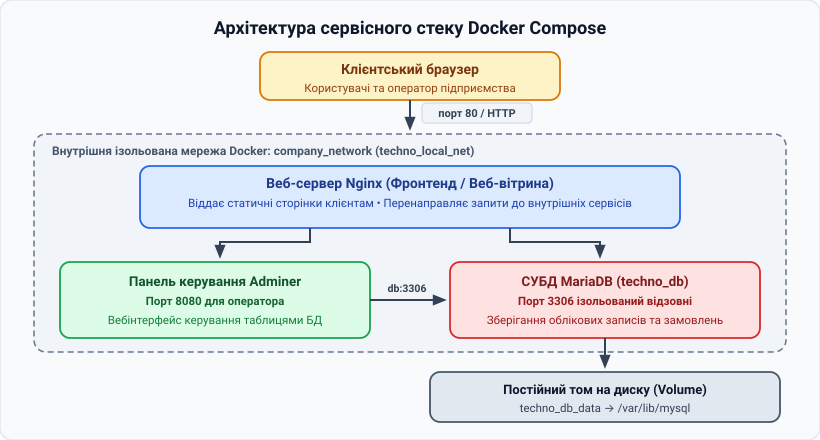

# Урок 56. Проєкт: розгортання серверних служб

<div class="how-to">

**Як працювати з уроком**

1. Ознайомтеся з теоретичними основами розгортання серверних служб, мережевою ізоляцією контейнерів та організацією збереження даних.
2. Виконайте покрокове практичне завдання: створіть конфігурацію мультиконтейнерного стеку для малого підприємства за допомогою Docker Compose, запустіть служби та перевірте їхню працездатність.
3. Дайте відповіді на 10 запитань підсумкового тесту наприкінці сторінки.

</div>

## Мета уроку

Ви дізнаєтеся, як на практиці перетворити спроєктовану на попередньому уроці архітектуру інформаційної системи на робоче серверне середовище, як ізолювати мережеві сервіси та гарантувати безпеку службових даних. На практиці ви:

- підготуєте робочу структуру каталогів та файл безпечних змінних середовища (`.env`);
- опишете стек серверних служб (веб-сервер Nginx, СУБД MariaDB та панель адміністрування Adminer) у маніфесті `docker-compose.yml`;
- розгорнете та запустите служби в ізольованій внутрішній мережі підприємства;
- налаштуєте постійні томи (*persistent volumes*) для захисту інформації від втрати при перезапуску;
- протестуєте мережеву доступність, перевірите логи та стан служб через командний рядок.

## Що знадобиться

- Операційна система Linux (Ubuntu 22.04/24.04 LTS, Debian 12 або підсистема WSL2 у Windows);
- Командний рядок (`bash`);
- Встановлений рушій **Docker Engine** та плагін **Docker Compose** (v2);
- Текстовий редактор (`nano`, `micro` або VS Code);
- Утиліти перевірки зв'язку `curl`, `netstat` (або `ss`) та будь-який сучасний веб-браузер.

## Теорія

На етапі проєктування інформаційної системи (Урок 55) було визначено функціональні потреби підприємства: наявність корпоративного веб-сайту, системи баз даних для обліку замовлень і товарів, а також інструменту адміністрування. Тепер перед оператором з обробки інформації постає завдання практичного розгортання цих служб.

### Способи розгортання: «на залізі» vs «у контейнерах»

Історично системні адміністратори встановлювали кожну службу безпосередньо в операційну систему хоста (`apt install nginx mariadb-server`). Проте такий підхід у сучасному IT-середовищі має суттєві недоліки:
- **Конфлікт залежностей:** різні програми можуть вимагати різних версій бібліотек чи інтерпретаторів;
- **Складність відновлення:** у разі аварії потрібно повторно виконувати десятки ручних команд налаштування;
- **Слабке розмежування:** збій або вразливість в одній службі ставлять під загрозу всю операційну систему.

Стандартом індустрії для малого та середнього бізнесу стало **контейнерне розгортання за допомогою Docker Compose**.

| Критерій | Нативне розгортання (хост-ОС) | Контейнеризація (Docker Compose) |
| :--- | :--- | :--- |
| **Швидкість розгортання** | Повільно (ручне встановлення пакетів) | Лічені секунди (`docker compose up -d`) |
| **Ізоляція процесів** | Спільний простір процесів і файлів | Повна ізоляція файлової системи й ресурсів |
| **Відтворюваність** | Залежить від поточного стану системи | 100% повторюваність на будь-якому сервері |
| **Управління стеком** | Кожну службу запускають окремо (`systemctl`) | Управління всіма службами одним файлом |
| **Очищення та видалення** | Залишає сміття в конфігураціях ОС | Видаляється без сліду однією командою |

### Архітектура сервісного стеку малого підприємства

Для типового сервісного підприємства (наприклад, станції техобслуговування або сервісного центру) мінімальний надійний стек складається з трьох ключових рівнів:

<div class="clip">



*Архітектура сервісного стеку Docker Compose: Nginx, Adminer, MariaDB та постійний том даних*

</div>

### Мережева безпека та прокидання портів

У Docker існує чітке розмежування між внутрішньою мережею контейнерів та зовнішньою мережею хоста:
1. **Прокидання портів (`ports: "HOST:CONTAINER"`):** робить порт контейнера доступним для зовнішнього світу. Наприклад, `"80:80"` відкриває доступ до веб-сайту для всіх комп'ютерів локальної мережі підприємства.
2. **Внутрішня мережа (`networks`):** контейнери в одній віртуальній мережі спілкуються між собою за **іменами служб** через вбудований DNS Docker. Порт СУБД `3306` не потрібно прокидати назовні — служба Adminer звертається до нього за внутрішнім мережевим ім'ям `db:3306`. Це захищає базу даних від зовнішніх сканувань та несанкціонованого доступу.

### Збереження даних (Data Persistence)

Контейнери за своєю природою є ефемерними (*stateless*): якщо контейнер видалити або перестворити, всі нові файли всередині нього зникнуть.
Щоб уникнути втрати критично важливої інформації, використовують **томи (Named Volumes)** або **монтування каталогів (Bind Mounts)**:
- **Named Volumes (`volumes: db_data:/var/lib/mysql`):** Docker самостійно управляє каталогом на сервері (`/var/lib/docker/volumes/...`), забезпечуючи максимальну швидкість читання/запису та цілісність даних СУБД;
- **Bind Mounts (`./html:/usr/share/nginx/html`):** конкретна папка з диска сервера монтується безпосередньо в контейнер, що зручно для редагування файлів веб-сайту оператором.

<div class="more-link">

**Хочете знати більше?** <span class="optional">Необов’язково</span>

- **Автоматичний перезапуск (`restart: unless-stopped`):** параметр конфігурації Docker, завдяки якому контейнери автоматично піднімаються після аварійного завершення процесу або перезавантаження всього фізичного сервера.
- **Шифрування SSL/TLS:** у виробничому середовищі Nginx налаштовують як зворотний проксі-сервер (*Reverse Proxy*), який приймає захищений трафік HTTPS на порту 443 із безкоштовними сертифікатами Let's Encrypt і передає запити внутрішнім службам.
- **Моніторинг працездатності (Healthcheck):** директива Docker, яка регулярно виконує перевірочну команду всередині контейнера (наприклад, `curl -f http://localhost/` або `mysqladmin ping`) і сигналізує, якщо сервіс завис, навіть коли сам процес ще активний.

</div>

## Покроково

Розгорнемо корпоративний сервісний стек підприємства: веб-сервер зі статичним сайтом-візиткою компанії, сервер бази даних MariaDB та веб-інтерфейс Adminer для оператора.

### 1. Підготовка робочого простору та структури каталогів

Створіть окрему робочу директорію проєкту та підкаталог для веб-сторінок. Це забезпечить порядок у файловій системі:

```bash
mkdir -p ~/enterprise-services/site-content
cd ~/enterprise-services
```

Створіть тестову головну сторінку підприємства в каталозі `site-content/index.html`:

```html
<!DOCTYPE html>
<html lang="uk">
<head>
    <meta charset="UTF-8">
    <title>Корпоративна мережа ТОВ «ТехноСервіс»</title>
    <style>
        body { font-family: sans-serif; margin: 40px; background: #f4f6f8; color: #333; }
        .card { background: white; padding: 25px; border-radius: 8px; box-shadow: 0 2px 4px rgba(0,0,0,0.1); }
        h1 { color: #0b5ed7; }
        .status { color: #198754; font-weight: bold; }
    </style>
</head>
<body>
    <div class="card">
        <h1>ТОВ «ТехноСервіс» — Інформаційна система</h1>
        <p>Статус сервера: <span class="status">Всі серверні служби працюють штатно</span></p>
        <p>Відповідальний оператор: <strong>Оператор з ОІПЗ (гр. 4113)</strong></p>
        <hr>
        <p>Доступні корпоративні ресурси: База даних обліку, Панель адміністрування (порт 8080).</p>
    </div>
</body>
</html>
```

### 2. Створення файлу конфіденційних змінних (.env)

Ніколи не записуйте відкриті паролі в основний маніфест `docker-compose.yml`! Створіть файл `.env` у корені проєкту `~/enterprise-services/`:

```bash
# Конфігурація бази даних MariaDB
MYSQL_ROOT_PASSWORD=SuperRootPass2026!
MYSQL_DATABASE=techno_service_db
MYSQL_USER=operator_it
MYSQL_PASSWORD=OperatorSecretKey2026!
```

### 3. Написання маніфесту розгортання docker-compose.yml

Створіть файл `docker-compose.yml`, який об'єднає веб-сервер, СУБД та панель керування в єдину ізольовану мережу `company_network`:

```yaml
version: '3.8'

services:
  # 1. Веб-сервер корпоративного порталу
  web:
    image: nginx:alpine
    container_name: techno_web
    restart: unless-stopped
    ports:
      - "80:80"
    volumes:
      - ./site-content:/usr/share/nginx/html:ro
    networks:
      - company_network

  # 2. Сервер реляційної бази даних
  db:
    image: mariadb:10.11
    container_name: techno_db
    restart: unless-stopped
    environment:
      MYSQL_ROOT_PASSWORD: ${MYSQL_ROOT_PASSWORD}
      MYSQL_DATABASE: ${MYSQL_DATABASE}
      MYSQL_USER: ${MYSQL_USER}
      MYSQL_PASSWORD: ${MYSQL_PASSWORD}
    volumes:
      - db_data:/var/lib/mysql
    networks:
      - company_network

  # 3. Веб-інтерфейс для роботи оператора з базою даних
  db_admin:
    image: adminer:latest
    container_name: techno_adminer
    restart: unless-stopped
    ports:
      - "8080:8080"
    depends_on:
      - db
    networks:
      - company_network

volumes:
  db_data:
    name: techno_db_data

networks:
  company_network:
    name: techno_local_net
    driver: bridge
```

### 4. Запуск сервісів та аналіз стану

Виконайте запуск сервісного стеку у фоновому режимі (демон):

```bash
docker compose up -d
```

Перевірте статус запущених контейнерів:

```bash
docker compose ps
```

Перевірте журнали подій, щоб переконатися у відсутності помилок ініціалізації бази даних:

```bash
docker compose logs db
```

### 5. Тестування працездатності та мережевої доступності

Перевірте відповідь веб-сервера через утиліту `curl`:

```bash
curl -I http://localhost
```

Відповідь сервера повинна містити статус `HTTP/1.1 200 OK`.

Відкрийте у браузері робочої станції:
- Головний веб-сайт: `http://localhost/` (або `http://<IP-адреса_сервера>/`);
- Панель Adminer: `http://localhost:8080/`. Для входу оберіть систему **MySQL**, сервер — `db` (системне ім'я контейнера), користувач — `operator_it`, пароль — значення з файлу `.env`, база даних — `techno_service_db`.

<div class="try">

**Спробуйте самі**

1. Перевірте список створених постійних томів Docker за допомогою команди `docker volume ls` та знайдіть там том `techno_db_data`.
2. Виконайте зупинку сервісів командою `docker compose down`, а потім знову запустіть їх командою `docker compose up -d`.
3. Зайдіть у панель Adminer (`http://localhost:8080`), створіть у базі таблицю `inventory` (стовпці: `id INT AUTO_INCREMENT PRIMARY KEY`, `item_name VARCHAR(100)`, `qty INT`) та додайте туди один тестовий запис (наприклад, "Маршрутизатор MikroTik", кількість: 3). Переконайтеся, що після зупинки та запуску контейнерів дані залишаються збереженими.

<details>
<summary>Перевірити очікуваний результат і повний розв’язок</summary>

Команда перевірки томів:
```bash
docker volume ls | grep techno
```

Очікуваний вивід:
```text
DRIVER    VOLUME NAME
local     techno_db_data
```

SQL-запит для створення таблиці в Adminer:
```sql
CREATE TABLE inventory (
    id INT AUTO_INCREMENT PRIMARY KEY,
    item_name VARCHAR(100) NOT NULL,
    qty INT NOT NULL DEFAULT 1
);

INSERT INTO inventory (item_name, qty) VALUES ('Маршрутизатор MikroTik', 3);
SELECT * FROM inventory;
```

Очікуваний результат виконання запиту:
```text
id | item_name              | qty
1  | Маршрутизатор MikroTik | 3
```

Команда перевірки доступності портів у системі:
```bash
ss -tulpn | grep -E ':(80|8080)'
```
Вивід підтвердить, що порти `80` (веб-сайт) та `8080` (Adminer) слухаються процесом `docker-proxy`.

</details>

</div>

## Підсумок

- Розгортання служб через **Docker Compose** забезпечує ізоляцію середовищ, швидкий запуск мультиконтейнерних стеків та 100% повторюваність конфігурації.
- Ізоляція мереж (`bridge network`) дозволяє приховати внутрішні службові порти СУБД (наприклад, `3306`) від зовнішнього доступу, дозволяючи звертатися до них лише авторизованим контейнерам за системними іменами служб.
- Використання іменованих томів (**Named Volumes**) гарантує надійне збереження даних при оновленні, зупинці або перестворенні контейнерів.
- Чутливі дані (паролі, назви баз даних) обов'язково виносяться у файл змінних середовища `.env`, який заборонено публікувати у відкритих джерелах.

## Тест

<div class="test-box">

10 запитань за матеріалом уроку. На початку тесту вкажіть **прізвище, ім’я та групу**.

🔗 <!-- GOOGLE_FORM_URL:lesson-56 --> *(Посилання на Google Форму буде додано після масового імпорту тесту)*

</div>

## Додаткове завдання

<span class="optional">Необов’язково</span> Виконуйте, якщо хочете поглибити навички адміністрування серверних середовищ.

**Базовий рівень.** Додайте до файлу `docker-compose.yml` директиву обмеження використання оперативної пам'яті (`mem_limit: 512m`) для служби бази даних `db` та перевірте стан споживання ресурсів командою `docker stats`.

**Проєктний рівень.** Створіть окремий конфігураційний файл `custom-nginx.conf` для сервера Nginx, у якому налаштуйте кастомну сторінку помилки 404 («Сторінку не знайдено») з контактами технічної підтримки оператора підприємства, і підключіть цей файл через директиву `volumes` у сервіс `web`.
