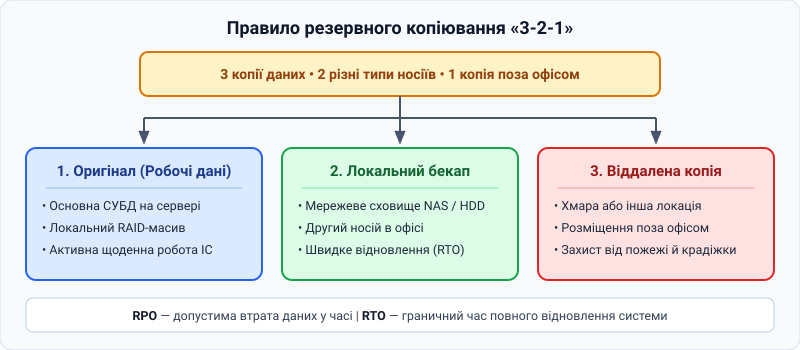
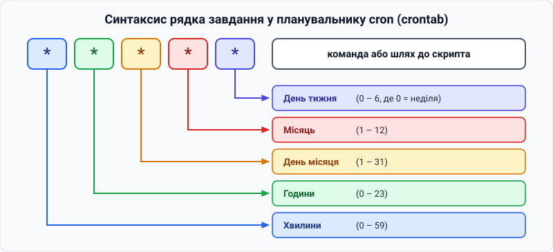

# Урок 57. Проєкт: план регламентного обслуговування інформаційної системи

<div class="how-to">

**Як працювати з уроком**

1. Ознайомтеся з класифікацією регламентних робіт інформаційної системи, правилом резервного копіювання «3-2-1» та принципами роботи планувальника `cron`.
2. Виконайте покрокове завдання: складіть технологічну карту регламентного обслуговування серверного комплексу та розробіть автоматизовані скрипти резервного копіювання й моніторингу дисків.
3. Дайте відповіді на 10 запитань підсумкового тесту наприкінці сторінки.

</div>

## Мета уроку

Ви дізнаєтеся, як організувати безперебійне функціонування інформаційної системи підприємства після її розгортання, навчитеся складати графіки технічного обслуговування та мінімізувати ризики простоїв. На практиці ви:

- сформуєте детальний план регламентних робіт (щоденних, щотижневих, щомісячних) для серверної інфраструктури малого підприємства;
- розробите Bash-скрипт для автоматизованого створення та ротації резервних копій бази даних і файлів конфігурації;
- створите скрипт моніторингу заповнення дискового простору з попередженням про критичний рівень;
- налаштуєте виконання регламентних завдань у системному планувальнику `cron`;
- оформите запис у журналі обліку технічного обслуговування згідно з вимогами посадової інструкції оператора.

## Що знадобиться

- Сервер або віртуальна машина під керуванням ОС Linux (Ubuntu/Debian) із розгорнутим стеком служб з Уроку 56;
- Командний інтерпретатор `bash` та права суперкористувача (`sudo`);
- Стандартні системні утиліти: `cron`, `tar`, `gzip`, `find`, `df`, `awk`;
- Офісний пакет **LibreOffice Calc** або **LibreOffice Writer** для оформлення карти регламентного обслуговування.

## Теорія

Розгортання серверних служб — це лише перший крок життєвого циклу інформаційної системи. Без системного контролю навіть найсучасніший сервер з часом зіткнеться з переповненням диска журналами (*лог-файлами*), збоями в базі даних, застарілими вразливими пакетами або апаратними несправностями.

**Регламентне технічне обслуговування (РТО)** — це комплекс обов'язкових періодичних профілактичних заходів, спрямованих на підтримання працездатності, продуктивності та безпеки інформаційної системи.

### Періодичність і види регламентних робіт

Згідно з професійними стандартами оператора з обробки інформації та програмного забезпечення (професія 4113), регламентні роботи поділяють за періодичністю:

| Періодичність | Основні операції регламенту | Інструменти / Команди |
| :--- | :--- | :--- |
| **Щодня** | Контроль активності служб, перевірка вільного місця на накопичувачах, аналіз помилок у журналах, створення нічного бекапу бази даних | `docker compose ps`, `df -h`, `journalctl -p err`, `docker exec ... mariadb-dump` |
| **Щотижня** | Повний бекап файлів і конфігурацій, аналіз безпеки (невдалі спроби входу), перевірка розміру каталогів з логами | `tar -czvf`, `lastb`, `journalctl -u ssh`, ротація `logrotate` |
| **Щомісяця** | Встановлення оновлень безпеки ОС та ПЗ, очищення застарілих образів та тимчасових файлів, тестове відновлення бекапу | `apt update && apt upgrade`, `docker system prune`, розгортання бекапу на тестовому ПК |
| **Щокварталу** | Апаратна діагностика накопичувачів, перевірка батарей ДБЖ (UPS), аудит облікових записів користувачів, ревізія плану DRP | `smartctl -H /dev/sdX`, фізичний огляд, вилучення заблокованих співробітників |

### Золоте правило резервного копіювання: «3-2-1»

Втрата інформаційної бази підприємства означає зупинку бізнесу та величезні фінансові збитки. Надійна стратегія резервного копіювання базується на правилі **3-2-1**:
- **3 копії:** основні робочі дані на сервері + мінімум дві резервні копії;
- **2 різні носії:** зберігання на різних фізичних типах носіїв (наприклад, локальний RAID-масив сервера та мережеве сховище NAS або зовнішній HDD);
- **1 копія поза офісом:** обов'язкова віддалена копія (в іншому фізичному офісі або захищеному хмарному сховищі) на випадок пожежі, затоплення чи викрадення обладнання.

<div class="clip">



*Схема правила резервного копіювання «3-2-1»*

</div>

Два ключові показники аварійного відновлення:
1. **RPO (Recovery Point Objective):** максимально допустимий обсяг втрати даних у часі. Якщо бекап бази виконується раз на добу о 02:00, RPO становить до 24 годин.
2. **RTO (Recovery Time Objective):** максимальний час, потрібний оператору для повного відновлення системи після аварії (наприклад, 2 години на розгортання з архіву).

### Автоматизація через планувальник завдань cron

Ручне виконання рутинних операцій веде до людських помилок («забув зробити бекап у п'ятницю»). В ОС Linux головним інструментом планування є служба **cron**.

Конфігураційний рядок у `crontab` складається з 5 часових полів та команди:
<div class="clip">



*Синтаксис рядка завдання у планувальнику cron*

</div>

Приклади регламентних завдань:
- `30 2 * * * /opt/scripts/backup.sh` — щоночі о 02:30;
- `0 3 * * 1 /opt/scripts/weekly_clean.sh` — щопонеділка о 03:00;
- `0 * * * * /opt/scripts/check_disk.sh` — щогодини (на початку кожної години).

<div class="more-link">

**Хочете знати більше?** <span class="optional">Необов’язково</span>

- **Діагностика дисків за стандартом S.M.A.R.T.:** утиліта `smartctl` (пакет `smartmontools`) дозволяє оцінити знос SSD-дисків (параметр *Percentage Used*) та стан пластин HDD (*Reallocated Sectors Count*). Зняття показів раз на місяць дозволяє замінити диск до того, як він раптово вийде з ладу.
- **Ротація журналів (Logrotate):** системний демон, який автоматично архівує громіздкі логи (`/var/log/nginx/*.log`), стискає їх у gzip та видаляє записи, старіші за встановлений термін (наприклад, 30 днів), запобігаючи аварійному заповненню диска.
- **Таймери systemd (systemd timers):** сучасна альтернатива `cron` у сучасних дистрибутивах Linux. Вони забезпечують точне журналювання кожного запущеного завдання в `journalctl` та вміють наздоганяти пропущені запуски після вимкнення живлення.

</div>

## Покроково

Розробимо комплекс регламентного обслуговування для інформаційної системи ТОВ «ТехноСервіс»: складемо технологічну карту, напишемо скрипти та налаштуємо розклад.

### 1. Формування карти регламентного технічного обслуговування

Створіть у LibreOffice Calc або текстовому файлі офіційну таблицю регламенту для оператора:

```text
================================================================================
КАРТА РЕГЛАМЕНТНОГО ОБСЛУГОВУВАННЯ ІНФОРМАЦІЙНОЇ СИСТЕМИ ТОВ «ТЕХНОСЕРВІС»
Затверджено: Керівник IT-відділу      Відповідальний: Оператор з ОІПЗ
================================================================================
№  | Періодичність | Найменування регламентної операції         | Норма часу | Метод контролю
---|---------------|--------------------------------------------|------------|-------------------
1  | Щодня (02:30) | Дамп СУБД MariaDB та стиснення gzip        | 5 хв (авто)| Лог /var/log/backup.log
2  | Щодня (08:30) | Перевірка статусу контейнерів Docker       | 3 хв       | docker compose ps
3  | Щодня (09:00) | Контроль заповнення дискового розділу (/)  | 2 хв (авто)| Лог /var/log/disk.log
4  | Щосуботи(03:00| Повний архів конфігурацій та веб-сайту     | 15 хв(авто)| Перевірка цілісності tar
5  | Щомісяця (1-е)| Оновлення пакетів ОС та Docker-образів     | 45 хв      | apt upgrade, reboot
6  | Щомісяця (2-е)| Тестове розгортання бекапу на стенді       | 30 хв      | Перевірка цілісності даних
7  | Щокварталу    | Діагностика S.M.A.R.T. накопичувачів       | 20 хв      | Звіт smartctl
```

### 2. Створення каталогу скриптів та налаштування сховища бекапів

Створіть системні каталоги для розміщення скриптів обслуговування та локального сховища архівів:

```bash
sudo mkdir -p /opt/maintenance/scripts
sudo mkdir -p /var/backups/techno_services
sudo chmod 700 /var/backups/techno_services
cd /opt/maintenance/scripts
```

### 3. Розробка скрипта резервного копіювання (backup_system.sh)

Створіть виконуваний файл `/opt/maintenance/scripts/backup_system.sh`:

```bash
#!/bin/bash
# ==============================================================================
# Скрипт автоматичного резервного копіювання ІС ТОВ «ТехноСервіс»
# Відповідальний: Оператор з обробки інформації та ПЗ
# ==============================================================================

BACKUP_DIR="/var/backups/techno_services"
DATE_TAG=$(date +"%Y%m%d_%H%M%S")
LOG_FILE="/var/log/it_maintenance.log"
PROJECT_DIR="/home/operator/enterprise-services"
RETENTION_DAYS=7

echo "[$(date '+%Y-%m-%d %H:%M:%S')] [ПОЧАТОК] Резервне копіювання служб..." >> "$LOG_FILE"

# 1. Дамп бази даних безпосередньо з контейнера MariaDB
DB_BACKUP_FILE="${BACKUP_DIR}/techno_db_${DATE_TAG}.sql.gz"
if docker exec techno_db mariadb-dump -u root -pSuperRootPass2026! techno_service_db 2>/dev/null | gzip > "$DB_BACKUP_FILE"; then
    echo "[$(date '+%Y-%m-%d %H:%M:%S')] [УСПІХ] База даних збережена: $DB_BACKUP_FILE" >> "$LOG_FILE"
else
    echo "[$(date '+%Y-%m-%d %H:%M:%S')] [ПОМИЛКА] Збій створення дампа СУБД!" >> "$LOG_FILE"
fi

# 2. Архівування конфігурацій та веб-вмісту сайту
CONF_BACKUP_FILE="${BACKUP_DIR}/techno_conf_${DATE_TAG}.tar.gz"
if tar -czf "$CONF_BACKUP_FILE" -C "$PROJECT_DIR" docker-compose.yml .env site-content 2>/dev/null; then
    echo "[$(date '+%Y-%m-%d %H:%M:%S')] [УСПІХ] Конфігурації збережено: $CONF_BACKUP_FILE" >> "$LOG_FILE"
else
    echo "[$(date '+%Y-%m-%d %H:%M:%S')] [ПОМИЛКА] Збій архівування конфігурацій!" >> "$LOG_FILE"
fi

# 3. Ротація: автоматичне видалення бекапів старіших за 7 днів
DELETED_COUNT=$(find "$BACKUP_DIR" -type f -name "*.gz" -mtime +$RETENTION_DAYS -delete -print | wc -l)
echo "[$(date '+%Y-%m-%d %H:%M:%S')] [РОТАЦІЯ] Видалено застарілих копій: $DELETED_COUNT" >> "$LOG_FILE"
echo "[$(date '+%Y-%m-%d %H:%M:%S')] [ЗАВЕРШЕНО] Резервування закінчено успішно." >> "$LOG_FILE"
```

Надайте скрипту права на виконання:
```bash
sudo chmod +x /opt/maintenance/scripts/backup_system.sh
```

### 4. Розробка скрипта моніторингу вільного місця (check_disk.sh)

Створіть скрипт контролю дискового простору `/opt/maintenance/scripts/check_disk.sh`:

```bash
#!/bin/bash
# Перевірка заповненості кореневого розділу сервера
THRESHOLD=85
LOG_FILE="/var/log/it_maintenance.log"

CURRENT_USAGE=$(df / | awk 'NR==2 {print $5}' | sed 's/%//')

if [ "$CURRENT_USAGE" -ge "$THRESHOLD" ]; then
    echo "[$(date '+%Y-%m-%d %H:%M:%S')] [УВАГА! ДИСК КРИТИЧНО ЗАПОВНЕНО]: Використано ${CURRENT_USAGE}%" >> "$LOG_FILE"
else
    echo "[$(date '+%Y-%m-%d %H:%M:%S')] [ОК] Дисковий простір у нормі: ${CURRENT_USAGE}%" >> "$LOG_FILE"
fi
```

Надайте права на виконання:
```bash
sudo chmod +x /opt/maintenance/scripts/check_disk.sh
```

### 5. Налаштування розкладу регламентних робіт у cron

Відкрийте системний файл розкладу суперкористувача:

```bash
sudo crontab -e
```

Додайте в кінець файлу наступні завдання:

```text
# 1. Щоденне резервне копіювання бази даних та конфігурацій о 02:30 ночі
30 2 * * * /opt/maintenance/scripts/backup_system.sh > /dev/null 2>&1

# 2. Щоденний моніторинг вільного місця на дисках кожні 3 години
0 */3 * * * /opt/maintenance/scripts/check_disk.sh > /dev/null 2>&1

# 3. Щотижневе очищення неактивних тимчасових контейнерів Docker (щонеділі о 04:00)
0 4 * * 0 /usr/bin/docker system prune -f > /dev/null 2>&1
```

### 6. Тестовий запуск та оформлення запису в журналі обслуговування

Виконайте ручний тестовий запуск скрипта бекапу:
```bash
sudo /opt/maintenance/scripts/backup_system.sh
sudo /opt/maintenance/scripts/check_disk.sh
```

Перегляньте записи в журналі обслуговування:
```bash
cat /var/log/it_maintenance.log
```

<div class="try">

**Спробуйте самі**

1. Перевірте вміст створеного архіву бази даних без його розпакування за допомогою утиліти `zcat` або команди перегляду вмісту архівованого tar: `tar -ztvf /var/backups/techno_services/techno_conf_*.tar.gz`.
2. Змоделюйте ситуацію збою: створіть тестову копію каталогу, видаліть один із файлів та відновіть його з бекапу.
3. Оформіть запис у картці оператора з обробки інформації: зафіксуйте точний розмір створеного архіву у мегабайтах (команда `ls -lh /var/backups/techno_services/`).

<details>
<summary>Перевірити очікуваний результат і повний розв’язок</summary>

Команда перевірки вмісту архіву конфігурації:
```bash
tar -ztvf /var/backups/techno_services/techno_conf_*.tar.gz
```

Очікуваний вивід:
```text
-rw-r--r-- operator/operator  1248 2026-11-16 10:15 docker-compose.yml
-rw------- operator/operator   180 2026-11-16 10:12 .env
drwxr-xr-x operator/operator     0 2026-11-16 10:10 site-content/
-rw-r--r-- operator/operator   850 2026-11-16 10:11 site-content/index.html
```

Перегляд розміру бекапів та запис у журнал:
```bash
ls -lh /var/backups/techno_services/
```

Зразок запису оператора в Журналі експлуатації ІС:
```text
[Дата: 16.11.2026 | Час: 11:30]
Оператор: Іваненко О. О. (гр. 4113)
Виконана робота: Проведено позапланову перевірку регламенту резервного копіювання.
Результат:
1. Дамп СУБД techno_db_20261116_113000.sql.gz сформовано успішно (розмір 42 КБ).
2. Архів конфігурації techno_conf_20261116_113000.tar.gz створено успішно (розмір 1.8 КБ).
3. Вільний дисковий простір розділу (/): 74% (норма). Зауважень до роботи служб немає.
Підпис оператора: [підпис]
```

</details>

</div>

## Підсумок

- **Регламентне технічне обслуговування (РТО)** — ключовий фактор стабільності, що запобігає аварійним зупинкам інформаційних систем завдяки профілактиці.
- Стратегія **«3-2-1»** гарантує стійкість бізнес-даних підприємства навіть у разі повної фізичної втрати одного сервера або локації.
- Планувальник завдань **cron** дозволяє повністю автоматизувати критичні рутинні операції: створення дампів баз даних, контроль вільного місця та ротацію логів.
- Ведення **журналу обліку регламентних робіт** є обов'язковим професійним стандартом оператора з обробки інформації (професія 4113).

## Тест

<div class="test-box">

10 запитань за матеріалом уроку. На початку тесту вкажіть **прізвище, ім’я та групу**.

🔗 <!-- GOOGLE_FORM_URL:lesson-57 --> *(Посилання на Google Форму буде додано після масового імпорту тесту)*

</div>

## Додаткове завдання

<span class="optional">Необов’язково</span> Виконуйте, якщо хочете поглибити навички автоматизації адміністрування.

**Базовий рівень.** Налаштуйте ротацію для створеного користувацького лог-файлу `/var/log/it_maintenance.log`: створіть конфігураційний файл `/etc/logrotate.d/it_maintenance`, у якому вкажіть щотижневу ротацію (`weekly`), збереження 4 архівів (`rotate 4`) та стиснення (`compress`).

**Проєктний рівень.** Модернізуйте скрипт `backup_system.sh`: додайте до нього надсилання сповіщення про успішний або невдалий бекап у корпоративний Telegram-канал або чат чергових операторів за допомогою команди `curl` та Telegram Bot API.
