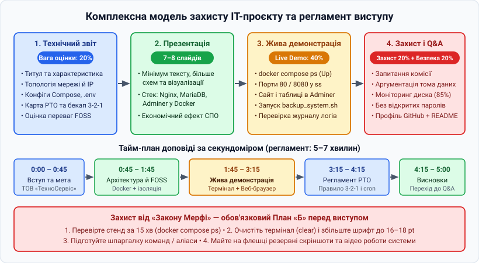

# Урок 58. Захист проєктів

<div class="how-to">

**Як працювати з уроком**

1. Ознайомтеся з вимогами до структури технічного звіту, правилами оформлення презентації та методикою проведення живої демонстрації (Live Demo).
2. Виконайте покрокове завдання: складіть чек-лист готовності до захисту, підготуйте 5-хвилинний сценарій доповіді та опрацюйте відповіді на типові запитання комісії.
3. Пройдіть підсумковий контрольний тест курсу на 10 запитань наприкінці сторінки.

</div>

## Мета уроку

Ви дізнаєтеся, як професійно презентувати результати своєї практичної та проєктної роботи перед екзаменаційною комісією чи замовником, як довести працездатність створеної системи та аргументувати інженерні рішення. На практиці ви:

- систематизуєте напрацювання модулів курсу в єдиний підсумковий технічний звіт;
- сформуєте структуру лаконічної та інформативної слайдової презентації (7–8 слайдів);
- складете покроковий сценарій живої демонстрації розгорнутих серверних служб і процедур регламентного обслуговування;
- відпрацюєте навички публічного технічного виступу з дотриманням часового регламенту (5–7 хвилин);
- підготуєте аргументовані професійні відповіді на запитання щодо безпеки, надійності та вибору технологій.

## Що знадобиться

- Повністю налаштований та робочий стенд проєкту (ОС Linux, Docker Compose, служби Nginx, MariaDB, Adminer та скрипти РТО з Уроків 56–57);
- Програма для створення презентацій (**LibreOffice Impress** або **Google Презентації**);
- Текстовий процесор (**LibreOffice Writer**) для оформлення пояснювальної записки / технічного паспорта проєкту;
- Веб-браузер і термінал для показу «живої системи»;
- Таймер або секундомір для самоконтролю регламенту виступу.

## Теорія

Захист проєкту — це кульмінаційний етап вивчення предмета «Комп’ютерні інформаційні технології» за професією 4113 «Оператор з обробки інформації та програмного забезпечення».

У реальній професійній діяльності IT-фахівцю недостатньо лише технічно розгорнути сервер: необхідно вміти захистити запропоноване рішення перед керівництвом, обґрунтувати витрати на обладнання, продемонструвати замовнику відповідність технічному завданню та довести безпеку збереження даних.

### Структура технічного звіту (пояснювальної записки)

Підсумковий звіт оператора є офіційним документом, що підтверджує кваліфікацію. Він має містити:

1. **Титульний аркуш:** заклад освіти, назва предмета, тема проєкту («Комплексна інформаційна система малого підприємства ТОВ «ТехноСервіс»»), прізвище та група виконавця, дані керівника.
2. **Вступ та характеристика об'єкта:** масштаби підприємства, кількість робочих місць, перелік бізнес-процесів, що автоматизуються.
3. **Архітектура та конфігурація ІС:** структурно-функціональна схема мережі, таблиця розподілу IP-адрес, специфікація апаратного забезпечення.
4. **Опис розгорнутого програмного комплексу:** обґрунтування вибору вільного ПЗ (Linux, Docker, Nginx, MariaDB), лістинги конфігураційних файлів (`docker-compose.yml`, `.env`), схеми прокидання портів.
5. **План регламентного обслуговування та безпеки:** технологічна карта РТО, опис алгоритмів резервного копіювання за правилом «3-2-1», тексти скриптів автоматизації та конфігурації `cron`.
6. **Висновки:** досягнуті показники надійності, переваги відкритого ПЗ (FOSS) для бюджету підприємства, перспективи подальшого розвитку системи.

### Правила побудови презентації виступу

Головне правило технічної доповіді — **інформативність замість перевантаження**. Комісія слухає виступ і дивиться на візуальні матеріали, а не читає дрібний текст зі слайдів.

| Слайд | Зміст слайда | Що говорити оператору |
| :--- | :--- | :--- |
| **1. Титульний** | Тема проєкту, виконавець (гр. 4113), заклад | Вітання, представлення, оголошення теми та мети роботи |
| **2. Постановка задачі** | Проблеми старого підходу та вимоги бізнесу | Опис потреб малого підприємства у власному веб-ресурсі та СУБД |
| **3. Архітектура мережі** | Топологічна схема, таблиця IP та портів | Короткий огляд організації внутрішньої підмережі та захисту |
| **4. Серверний стек** | Схема контейнеризації Docker Compose | Обґрунтування ізоляції служб (Nginx, MariaDB, Adminer) |
| **5. Демонстрація системи** | Скріншоти та перехід до Live Demo | Показ реальної роботи сервісів у терміналі та браузері |
| **6. Регламент та бекапи** | Схема правила «3-2-1», фрагмент crontab | Як забезпечено захист від втрати даних та автоматизовано РТО |
| **7. Економічний ефект** | Порівняння комерційного та FOSS рішень | Відсутність ліцензійних витрат завдяки СПО, швидке відновлення |
| **8. Висновки** | Ключові результати, контакти, підпис | Підсумок виконання завдання, подяка за увагу, готовність до питань |

### Мистецтво Live Demo та «Закон Мерфі»

Жива демонстрація системи справляє на комісію та роботодавців значно сильніше враження, ніж статичні картинки. Проте в IT існує відомий **«закон Мерфі для демо»**: *будь-яка система, яка бездоганно працювала вдома, має тенденцію зависати або видавати помилку саме під час презентації перед аудиторією*.

**Золоті правила підготовки демонстрації:**
- **Попередня перевірка:** за 15 хвилин до виступу перевірте статус служб (`docker compose ps`) та тестове відкриття веб-сторінок.
- **Чистота термінала:** перед виступом очистіть термінал командою `clear`, збільште шрифт до комфортного для читання з проєктора (мінімум 16–18 pt).
- **Підготовлені команди:** не друкуйте довгі шляхи вручну під час хвилювання — створіть короткі аліаси або тримайте шпаргалку з командами.
- **План «Б» (Backup Plan):** на випадок раптового вимкнення електрики, обриву кабелю чи збою хоста обов'язково майте на флешці резервні скріншоти та коротке відео роботи системи.

### Критерії оцінювання проєкту

Оцінка за проєкт формується комплексно за такими напрямами:
1. **Практична працездатність (40%):** чи всі заявлені служби стартують, чи доступні порти, чи зберігаються дані в томах.
2. **Якість технічної документації (20%):** грамотність пояснювальної записки, наявність схем, лістингів, коректність коментарів у скриптах.
3. **Регламент та безпека (20%):** наявність чіткої стратегії резервування, скрипта автоматизації, файлу `.env` без відкритих паролів у репозиторії.
4. **Захист та відповіді на запитання (20%):** впевненість виступу, дотримання таймінгу 5–7 хвилин, професійна термінологія.

<div class="clip">



*Рис. Комплексна модель захисту ІТ-проєкту, критерії оцінювання та тайм-план виступу*

</div>

<div class="more-link">

**Хочете знати більше?** <span class="optional">Необов’язково</span>

- **Формування IT-портфоліо:** документацію проєкту та файл `docker-compose.yml` разом зі скриптами рекомендується завантажити у власний публічний репозиторій на **GitHub** (зі створенням детального файлу `README.md`). Посилання на такий репозиторій у резюме різко підвищує шанси випускника отримати роботу молодшого системного адміністратора або технічного фахівця підтримки.
- **Гнучкість мислення під час Q&A:** якщо член комісії ставить запитання, точної відповіді на яке ви не знаєте, неприпустимо мовчати чи вигадувати неіснуючі факти. Професійна відповідь оператора: *«У межах базової конфігурації проєкту цей модуль не реалізовувався, проте відповідно до технічної документації MariaDB для цього використовується директива X, і я можу інтегрувати її під час наступного етапу модернізації»*.
- **Soft Skills для технічного спеціаліста:** вміння слухати запитання до кінця, стриманість, повага до співрозмовника та грамотна професійна українська мова є не менш важливими за вміння писати код конфігурацій.

</div>

## Покроково

Підготуємо комплекс матеріалів для бездоганного захисту практичного проєкту перед комісією.

### 1. Формування чек-листа готовності до захисту (Pre-defense Checklist)

Створіть і заповніть індивідуальний контрольний лист готовності оператора:

```text
[ ] 1. ТЕХНІЧНА ЧАСТИНА:
    [+] Серверні контейнери запущені та знаходяться в статусі Up (healthy).
    [+] Порти 80 та 8080 відкриті та відповідають за протоколом HTTP.
    [+] Перевірено збереження записів бази даних у томі techno_db_data.
    [+] Скрипти бекапу та моніторингу мають права на виконання (chmod +x).
    [+] В crontab додано завдання з розкладом автоматичного обслуговування.

[ ] 2. ДОКУМЕНТАЦІЯ:
    [+] Пояснювальна записка роздрукована або збережена у форматі PDF.
    [+] Технологічна карта РТО підписана оператором.
    [+] Схема топології мережі експортована у високій роздільній здатності.

[ ] 3. ПРЕЗЕНТАЦІЯ ТА ДЕМОНСТРАЦІЯ:
    [+] Файл презентації (7–8 слайдів) перевірено на сумісність із LibreOffice Impress.
    [+] Шрифт термінала збільшено для демонстрації на проєкторі.
    [+] Підготовлено резервну папку зі скріншотами працездатності (План «Б»).
```

### 2. Складання погодинного тайм-плану виступу на 5 хвилин

Розподіліть 5 хвилин свого виступу за секундоміром:

- **0:00 – 0:45 (Вступ):** «Доброго дня, шановні члени комісії! До вашої уваги представляється проєкт комплексної інформаційної системи для малого підприємства ТОВ «ТехноСервіс»...»
- **0:45 – 1:45 (Архітектура та вибір FOSS):** «Головною метою було створення надійної, автономної та економічно вигідної інфраструктури без витрат на дорогі пропрієтарні ліцензії. Архітектура побудована на базі ОС Linux та ізольованих контейнерів Docker Compose...»
- **1:45 – 3:15 (Жива демонстрація Live Demo):** Демонстрація консолі, статусів контейнерів, веб-інтерфейсу сайту та панелі Adminer.
- **3:15 – 4:15 (Обслуговування та безпека):** «Для гарантії безперервності бізнесу реалізовано правило резервування «3-2-1». Написано bash-скрипт бекапу СУБД із ротацією та автоматизовано його запуск у cron щоночі...»
- **4:15 – 5:00 (Висновки):** «Запропонований комплекс повністю розгорнуто, протестовано та підготовлено до експлуатації. Дякую за увагу! Готовий відповісти на ваші запитання».

### 3. Сценарій живої демонстрації (Live Demo Script)

Підготуйте точну послідовність дій для термінала та браузера під час презентації:

```bash
# Крок 1: Демонстрація статусу та ізоляції контейнерів
docker compose ps

# Крок 2: Демонстрація відкритих портів у системі
ss -tulpn | grep -E ':(80|8080)'

# Крок 3: Перехід у веб-браузер
# - Відкрити вкладку: http://localhost (демонстрація корпоративної сторінки)
# - Відкрити вкладку: http://localhost:8080 (вхід в Adminer, показ таблиці inventory)

# Крок 4: Демонстрація регламентного обслуговування (ручний запуск бекапу)
sudo /opt/maintenance/scripts/backup_system.sh

# Крок 5: Показ сформованого дампа та запису в системному лозі
ls -lh /var/backups/techno_services/
tail -n 5 /var/log/it_maintenance.log
```

### 4. Опрацювання відповідей на типові запитання комісії

Ознайомтеся з найпоширенішими запитаннями екзаменаторів та підготуйте чіткі формулювання:

1. **Запитання:** *«Чому ви обрали MariaDB, а не комерційну Microsoft SQL Server?»*  
   **Відповідь:** *«MariaDB є вільною СУБД із відкритим сирцевим кодом (FOSS), що повністю покриває потреби малого сервісного підприємства, споживає значно менше апаратних ресурсів і не потребує щорічних витрат на дорогі ліцензії»*.
2. **Запитання:** *«Як забезпечено збереження даних бази, якщо контейнер впаде або буде перестворений?»*  
   **Відповідь:** *«Використано постійний іменований том Docker Named Volume `techno_db_data`, підключений до каталогу `/var/lib/mysql`. Дані зберігаються на диску хоста незалежно від життєвого циклу контейнера»*.
3. **Запитання:** *«Що станеться, якщо диск сервера переповниться?»*  
   **Відповідь:** *«У системі налаштовано скрипт моніторингу `check_disk.sh`, який кожні 3 години перевіряє розділ і фіксує перевищення порогу 85%, а в скрипті бекапу діє автоматична ротація видалення копій, старіших за 7 днів»*.

<div class="try">

**Спробуйте самі**

1. Запустіть секундомір на смартфоні або комп'ютері.
2. Проведіть повну «генеральну репетицію» свого виступу вголос: проговоріть текст доповіді від привітання до висновків і паралельно виконайте всі 5 кроків сценарію Live Demo в терміналі та браузері.
3. Зафіксуйте час: якщо виступ тривав понад 6 хвилин — скоротіть вступну частину; якщо менше 4 хвилин — докладніше розкрийте схему регламентного обслуговування.

<details>
<summary>Перевірити очікуваний результат і повний розв’язок</summary>

Зразок структури підсумкового слайд-шоу в LibreOffice Impress:
```text
Слайд 1: Заголовок «Комплексна інформаційна система підприємства ТОВ «ТехноСервіс»»
         Автор: здобувач освіти групи 4113 [ПІБ]
         Керівник: [ПІБ викладача]
Слайд 2: Мета та задачі (автоматизація сервісу, забезпечення надійності, мінімізація бюджету).
Слайд 3: Структурна схема локальної мережі та конфігурація серверного обладнання.
Слайд 4: Стек розгортання: Docker Compose, Nginx (порт 80), MariaDB (ізольована), Adminer (порт 8080).
Слайд 5: [ПЕРЕХІД ДО LIVE DEMO: статус контейнерів, веб-портал, таблиця інвентаризації].
Слайд 6: Регламент обслуговування: графік РТО, скрипт backup_system.sh, cron (02:30), правило 3-2-1.
Слайд 7: Техніко-економічне обґрунтування: повна автономність на базі відкритого ПЗ Linux/FOSS.
Слайд 8: Підсумки проєкту. «Дякую за увагу! Готовий до запитань».
```

Очікуваний час виступу: **4 хвилини 45 секунд** (ідеальне потрапляння в регламент).

Очікуваний стан термінала після Live Demo:
- Всі сервіси `Up`;
- Дамп бази збережений та має ненульовий розмір;
- Журнал `/var/log/it_maintenance.log` містить статус `[УСПІХ]`.

</details>

</div>

## Підсумок

- Успішний захист проєкту поєднує якісно оформлений **технічний звіт**, наочну **презентацію** та переконливу **живу демонстрацію** працездатності системи.
- Суворе дотримання **регламенту часу (5–7 хвилин)** та наявність **плану «Б»** (резервні скріншоти) є ознакою високої професійної культури технічного фахівця.
- Впевнені та аргументовані відповіді на запитання комісії базуються на розумінні логіки вибору технологій (переваги FOSS, Docker Compose, правила 3-2-1).
- Виконаний проєкт є основою першого професійного **портфоліо** оператора з обробки інформації та програмного забезпечення для успішного працевлаштування.

## Тест

<div class="test-box">

10 запитань за матеріалом уроку. На початку тесту вкажіть **прізвище, ім’я та групу**.

🔗 <!-- GOOGLE_FORM_URL:lesson-58 --> *(Посилання на Google Форму буде додано після масового імпорту тесту)*

</div>

## Додаткове завдання

<span class="optional">Необов’язково</span> Виконуйте, якщо хочете підготувати власне портфоліо до співбесіди з роботодавцем.

**Базовий рівень.** Створіть у текстовому процесорі LibreOffice Writer титульний аркуш та зміст пояснювальної записки до випускного проєкту згідно з вимогами державних стандартів до оформлення навчально-технічної документації.

**Проєктний рівень.** Оформіть структуру власного професійного GitHub-репозиторію для випускного проєкту: складіть файл `README.md` з бейджами технологій, архітектурною діаграмою у форматі Markdown/Mermaid та детальною інструкцією зі швидкого розгортання системи для стороннього користувача (`Quick Start Guide`).
